<p align="center">
  
</p>

# Voxenra

[简体中文](README.md) | [English](README.en.md)

[Product website](https://l5769389.github.io/voxenra/en-us/) · [Online manual](https://l5769389.github.io/voxenra/en/)

A cross-platform DICOM workspace for CT, MR, and PET viewing, reconstruction, fusion, measurement, and segmentation. Includes **local AI auto-segmentation with TotalSegmentator**, with results ready to review, refine, and save.

[macOS · Apple Silicon](https://github.com/l5769389/voxenra/releases/download/v2.1.5/Voxenra-2.1.5-macos-arm64.dmg) · [Windows · Installer](https://github.com/l5769389/voxenra/releases/download/v2.1.5/Voxenra-2.1.5-windows-x64-setup.exe) · [Windows · Portable](https://github.com/l5769389/voxenra/releases/download/v2.1.5/Voxenra-2.1.5-windows-x64-portable.exe) · [Releases](https://github.com/l5769389/voxenra/releases)


## Features

| Area | Capabilities |
| --- | --- |
| Local images | Mixed file, folder, and ZIP / RAR / 7z / TAR archive selection, drag-and-drop, background import, and DICOM tags. |
| PACS | DICOMweb query and download; supports traditional DICOM (DIMSE) connection tests, queries, and retrieval. |
| 2D and comparison | Windowing, inversion, color maps, playback, montage, custom viewports, and 2–4 series comparison with patient-space or relative-progress linking. |
| Reconstruction and 3D | Three-plane and oblique MPR, thick slabs, dual-series MPR comparison, volume rendering, presets, cropping, CT bed removal, and multi-phase CT 4D. |
| PET/CT fusion | Linked CT, PET, fused, and MIP views; SUV/source units, manual rigid registration, blending, and fused 3D. |
| Measurement and annotation | Length, angle, curve, rectangle, ellipse, and free-shape ROIs; text and arrows, list management, copy/paste, undo and redo. |
| Segmentation and VOI | CT/PET thresholding and spherical/ellipsoidal VOIs; CT/MR/PET mask management, paint/erase, connected-region editing, and statistics. |
| Local AI | TotalSegmentator fast CT multi-organ segmentation: search and select structures, review overlays, refine, undo, and save. |
| Analysis and export | CT water phantom QA/circular ROIs, point-source MTF, ramp FWHM and slice thickness; PNG, DICOM, CSV/PDF, SEG/SR, and NRRD. |
| Workspaces and preferences | Tabs, detached windows, create/save/recover, retained results from closed tabs, themes, languages, input/display settings, and an offline manual. Supports toolbar ordering, preset favorites, and reading-area maximization. |

## From PACS query to viewing

Manage multiple PACS connections in **Settings → Sources**, search by patient, accession number, modality, or date, then select series to import in the background and open in 2D. Continue into MPR, 3D, or Tag views. Imports provide progress, cancellation, and duplicate-series merging; results enter the workspace only after complete validation.

- **DICOMweb:** QIDO-RS queries and WADO-RS downloads, with no authentication, Basic, or Bearer.
- **Traditional DICOM (DIMSE):** C-ECHO testing, Study Root C-FIND queries, C-MOVE retrieval, and a temporary C-STORE receiver during import. Configure the PACS address and remote AE, local receiving AE, listening IPv4 address, and port; register a reachable destination on the PACS as well.

[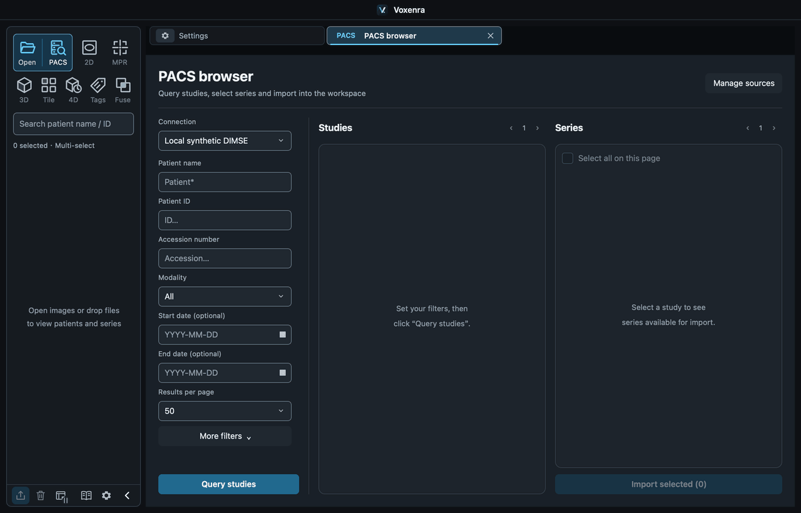](docs/screenshots/en/51-dimse-settings.png)

Native UI demonstration using a real local DIMSE service and synthetic DICOM data. C-ECHO verifies connectivity; query permissions and the return path require an actual series import. Current DIMSE support excludes C-GET, DICOM TLS, upload, and a permanent receiver. See [PACS configuration](docs/pacs.md) and [integration scope](docs/validation/dicom-dimse.md).

## Local AI segmentation · TotalSegmentator

Go from CT viewing to editable organ segmentation in the same workspace:

- **Choose structures**: Search and select supported organs in CT MPR / 4D, with liver, spleen, and both kidneys selected by default.
- **Run locally**: Connect an existing TotalSegmentator environment and process the full CT volume of the current phase using available CUDA, Apple MPS, or CPU devices.
- **Keep editing**: Review overlays in three planes, refine with paint/erase, toggle visibility, undo, and save a workspace or export SEG / NRRD.

[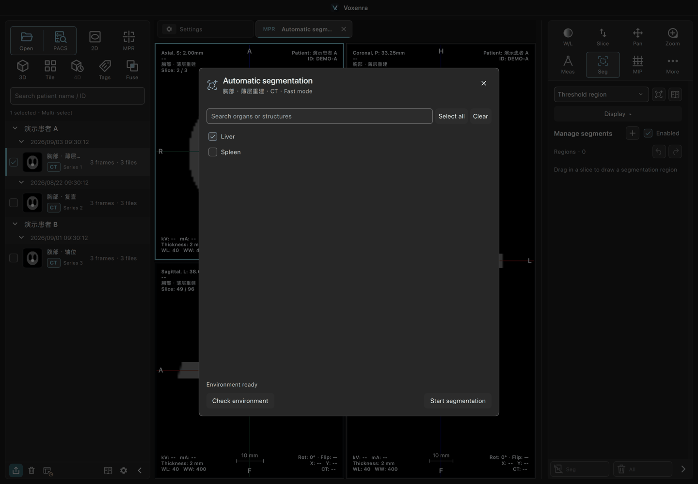](docs/screenshots/en/48-ai-complete-2.1.1.png)

Recorded in the current application using a synthetic phantom and simulated inference output to demonstrate selection, failure, retry and successful import; this does not indicate model accuracy or runtime. Install TotalSegmentator and its CT fast model separately, then check the environment in **Settings → AI**. Review and refine automatic results.

[Setup and workflow guide](https://l5769389.github.io/voxenra/en/segmentation.html) · [TotalSegmentator project](https://github.com/wasserth/TotalSegmentator)

## 2D viewing and comparison

Switch each viewport between original slices and axial/coronal/sagittal reconstructions, retaining its position and display state. CT/MR support windowing and inversion; PET uses quantitative display ranges. Drag series into layouts, create grids up to 6 × 6, or double-click to enlarge a viewport.

**Compare 2–4 series** with separate switches for scrolling, windowing, zoom, and other display operations. Re-enabling a sync option uses the selected viewport as its source. Compatible patient spaces support position linking, reference lines, and Alt-click location; relative-progress mode compares series with different slice counts. MR defaults to independent windowing and inversion. Neither linking mode performs automatic registration.

<table>
<tr>
<td width="50%"><b>MR viewing</b><br><a href="docs/screenshots/07-mr-reading.png"></a></td>
<td width="50%"><b>Custom 2D layout</b><br><a href="docs/screenshots/10-2d-layout.png"></a></td>
</tr>
</table>

### Identify images, favorite presets, and focus on viewing

Tabs prioritize the original series description on the first line, with patient and available study information below. Missing fields are omitted; hover for full source details. Identity-hiding settings also cover the new reading labels. Window values consistently use **WW → WL**. Star CT presets to place favorites first; starring does not apply window values, and the preset list scrolls independently.

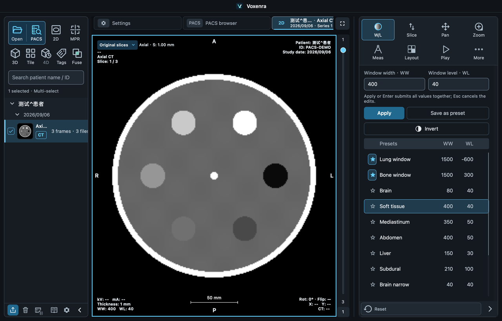

Click **Maximize image area** at the end of the tab bar, or press **F12** (Fn+F12 on some Mac keyboards), to hide both side panels and button rails. Repeat to restore their widths and expanded states. This affects only the current window and is independent of single-viewport enlargement and system full screen.

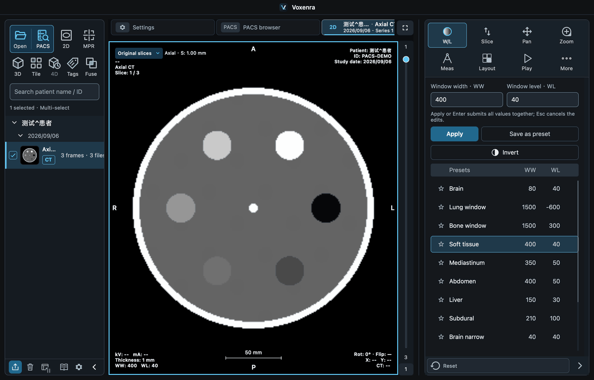

## MPR, 3D, and 4D

- **MPR:** linked axial, coronal, and sagittal planes, oblique reconstruction, seven layouts, and MIP / MinIP / Mean / Sum thick slabs; four-up layouts add 3D spatial references and linked rotation.
- **3D:** CT, MR, and PET volume rendering with presets, windowing, orientation, rotation, and region cropping; 20 CT presets and CT bed removal.
- **4D:** synchronized multi-phase CT playback, with segmentation and VOI stored by phase; separate slice playback within the current phase.

**Dual-series MPR comparison** keeps position, rotation, CT windowing, and physical display-scale switches visible. Groups start independently. Enabling window/scale sync uses the selected group; position/rotation linking preserves existing offsets and synchronizes subsequent changes. Double-click to enlarge corresponding planes side by side. Linking does not perform automatic registration.

**MPR layouts:** switch between three-plane and 3D arrangements, maximize a viewport, and remember the layout.


<table>
<tr>
<td width="50%"><b>Oblique MPR</b><br><a href="docs/screenshots/14-oblique-mpr.png"></a></td>
<td width="50%"><b>Dual-series MPR</b><br><a href="docs/screenshots/09-mpr-compare.png"></a></td>
</tr>
</table>

**3D presets and rotation**


**4D playback**


## PET/CT fusion

View CT, PET, fused planes, and whole-volume MIP together. Adjust orientation, color maps, and blending; perform manual rigid registration. PET provides SUV or source activity units when metadata allows, with VOI/threshold statistics computed from quantitative source data in the slice views. Fused 3D has separate CT and PET display controls.


<table>
<tr>
<td width="50%"><b>2D fusion</b><br><a href="docs/screenshots/05-pet-ct-fusion.png"></a></td>
<td width="50%"><b>3D fusion</b><br><a href="docs/screenshots/06-fusion-3d.png"></a></td>
</tr>
</table>

## Measurement, segmentation, and reporting

- **Measurements and annotations:** length, angle, curve, rectangle, ellipse, and free-shape ROIs, with area, perimeter, and intensity statistics; text/arrows, list navigation, renaming, visibility, locking, copy/paste, undo and redo.
- **Segmentation and VOI:** CT/PET thresholding and spherical/ellipsoidal VOIs; CT/MR/PET masks support paint/erase and keep/remove connected regions. Convert free-shape ROIs to single-slice segments, adjust outline/fill and opacity, manage regions, undo and redo.
- **Results:** export measurements as CSV/PDF or DICOM SR, with matching reference images in PDFs; exchange segments through DICOM SEG or NRRD / Slicer, preserving overlap, names, and colors.

**Free-shape measurement:** click to place control points and create a smooth closed contour.


**Curve measurement:** place a few controls to measure the physical arc length of a smooth path.


**Segmentation refinement:** paint and erase with millimeter or view-relative diameters, on the current slice or with a 3D spherical brush.


<table>
<tr>
<td width="50%"><b>Associated results import</b><br><a href="docs/screenshots/33-associated-import.png"></a></td>
<td width="50%"><b>Segmentation and report export</b><br><a href="docs/screenshots/32-structured-report.png"></a></td>
</tr>
</table>

### CT quality analysis

- **QA:** water phantom CT number, noise, and uniformity. When no usable water phantom is detected, five editable circular ROIs provide sampling statistics. Move, copy, delete, regenerate, undo, or redo initial ROIs and copies; water-phantom summaries appear only when their prerequisites are met.
- **MTF / FWHM:** point-source MTF curves and spatial resolution, plus ramp-line FWHM and slice-thickness analysis. Workspaces retain completed results, ROIs, and parameters.

<table>
<tr>
<td width="50%"><b>CT water phantom QA</b><br><a href="docs/screenshots/en/19-water-qa-2.1.3.png">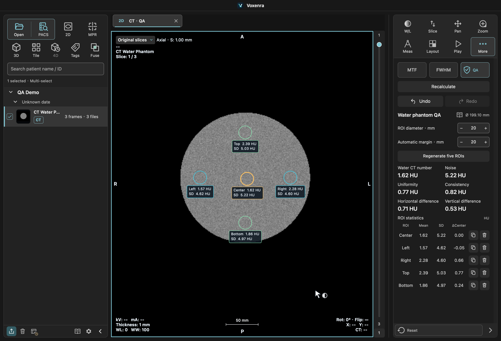</a></td>
<td width="50%"><b>Point-source MTF</b><br><a href="docs/screenshots/28-mtf-analysis.png"></a></td>
</tr>
</table>

## Data and workspaces

Import source DICOM images on the left and associated SEG / NRRD masks through **Import segmentation** on the right (named “Import” in v2.1.3). Export source series as PNG or DICOM, or save the current view as a PNG screenshot. Series export and viewport screenshots have different content scopes; see [export details](docs/export.md).

Drag tabs into detached windows or move them between windows. Workspaces preserve image references, layouts, measurements, segmentation masks, analysis results, selected tools, and refinement settings, with automatic recovery. Start a blank workspace; closing a tab retains editing results, reopenable from the workspace panel or Ctrl+Shift+T / ⇧⌘T. Exiting prompts to save workspace changes. Keep source files available: workspaces store references and results, not source pixels, unfinished drafts, or undo history. Choose dark, neutral gray, or light themes; use local JSON language packs and window presets, an offline manual with playable, pausable, and zoomable workflow demos, feedback, and optional startup update checks.

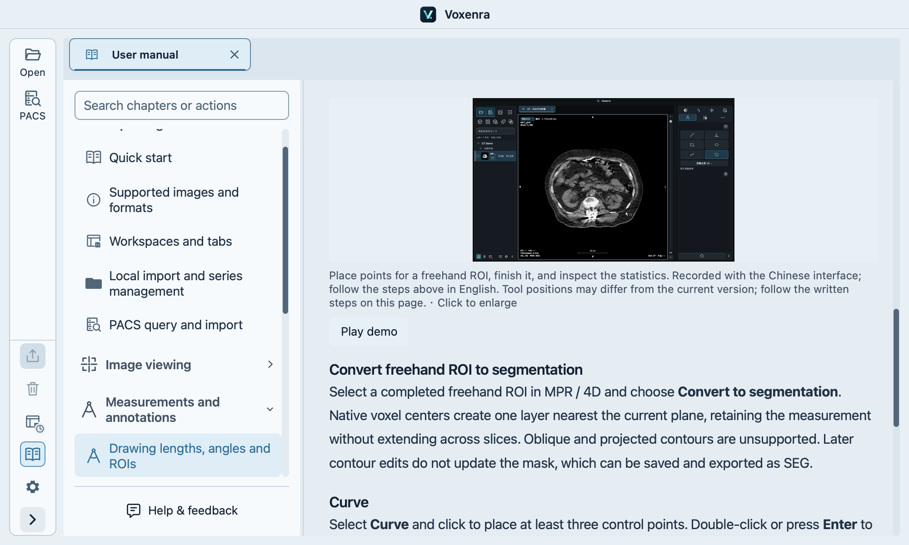

<table>
<tr>
<td width="50%"><b>Imported workspace</b><br><a href="docs/screenshots/en/45-workspace-home-2.1.3.png">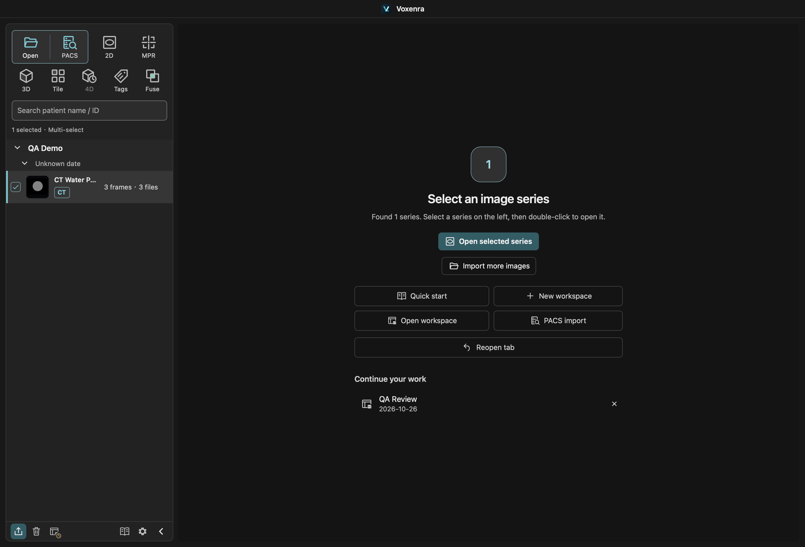</a></td>
<td width="50%"><b>PACS browser</b><br><a href="docs/screenshots/16-pacs-browser.png"></a></td>
</tr>
<tr>
<td><b>Detached window</b><br><a href="docs/screenshots/13-detached-tabs.png"></a></td>
<td><b>Workspace recovery</b><br><a href="docs/screenshots/en/17-workspace-2.1.3.png">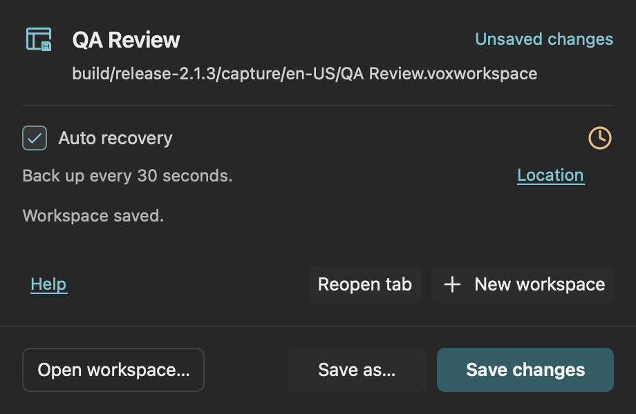</a></td>
</tr>
</table>

Favorite frequently used folders in the image picker and click a card at the top to browse it. Use **×** on the active card to remove the favorite. **Manage favorites** supports drag ordering, renaming, and replacing paths; changes persist after restart.

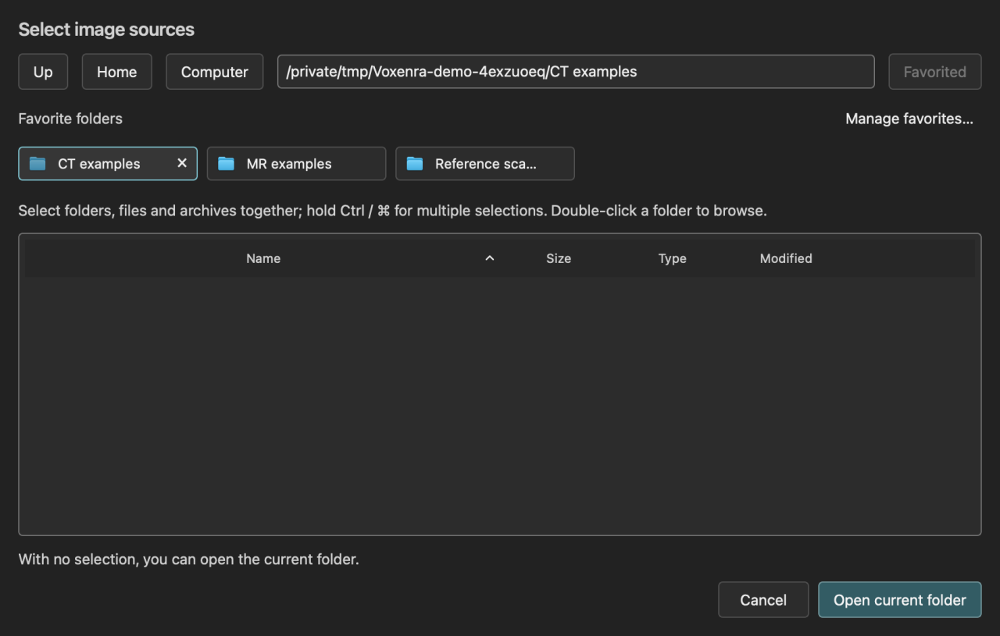

## Appearance and controls

Choose **dark, neutral gray, or light** in **Settings → Appearance & language**. Neutral gray combines graphite panels with restrained cyan accents. Theme changes apply immediately and persist after restart; image windowing and color maps remain independent.


[Dark theme](docs/screenshots/25-theme-dark.png) · [Light theme](docs/screenshots/26-theme-light.png)

Adjust interface size, mouse bindings, wheel direction, and tool shortcuts in Settings. Conflicting or reserved shortcuts are rejected. Edit corner information directly with sample values, drag within or between corners, and add or remove fields; changes save on release. Crosshairs, scales, measurement styles, and ROI metrics remain configurable. Chinese, English, and Brazilian Portuguese are built in, with support for additional local JSON language packs. Independent switches show labels for sidebar actions and right-side tools. Privacy options control identity overlays in new views and let you clear recent workspace entries.

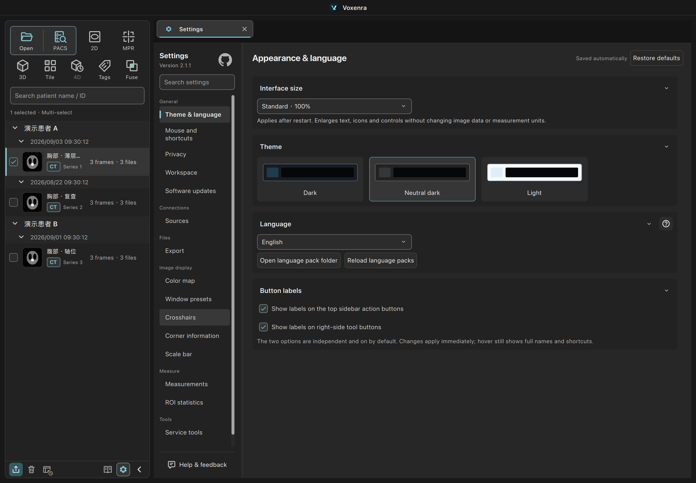

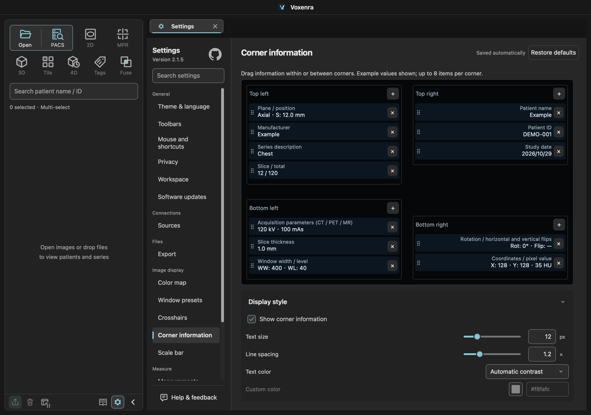

[Mouse bindings and tool shortcuts](docs/screenshots/40-input-settings.png)

### Arrange tools for each viewing task

In **Settings → Toolbars**, arrange left-side view shortcuts and right-side **Common / More** tools. Choose from six categories: **2D reading, MPR reconstruction, 3D, Montage, 4D, and Fusion**. Expand the detailed options to configure single-series/comparison modes and image types separately.

Drag icon tiles to reorder or move between groups, or select a tile and use move/transfer controls. Common tools are limited to seven. Changes remain a draft until **Save** applies them to all windows and persists them; **Cancel** discards the draft, and **Restore current default** affects only the current configuration. File, PACS, and bottom system entries stay fixed.

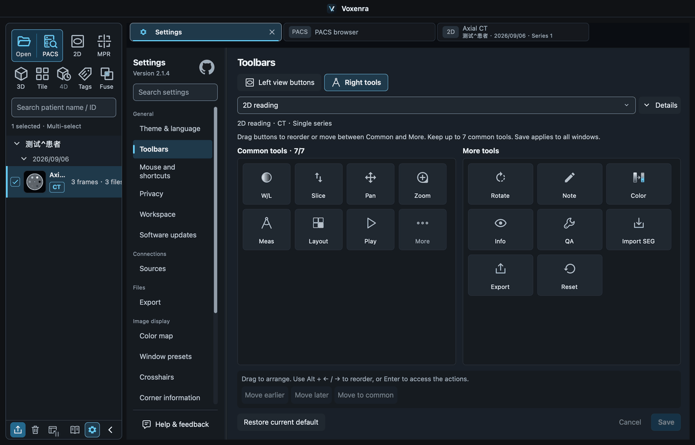

Published packages support verified downloads and in-app updates. Update prompts show a concise summary in the selected interface language, with access to full release notes. [Update dialog](docs/screenshots/en/43-update-summary.png)

[Series export completion](docs/screenshots/en/46-export-complete-2.1.1.png) · [Automatic segmentation retry](docs/screenshots/en/47-ai-error-2.1.1.png)

[View the interface gallery](docs/screenshots/README.md)

## Supported formats and limits

- Supports conventional CT/MR, classic static/whole-body PET, Enhanced CT/MR, and RLE, JPEG, JPEG-LS, and JPEG 2000 pixel decoding. MPR/3D require regular spatial sampling; PET quantification depends on metadata. Enhanced CT phases are browsed as groups and are not currently connected to 4D playback.
- Common RGB, YBR, and PALETTE COLOR DICOM support 2D viewing, montage, multi-frame playback, and PNG export. Physical measurements require valid pixel spacing; color MPR / 3D and HU analysis are unavailable.
- NRRD supports current-phase volume export and segmentation import/export on the matching source grid. Standalone NRRD image viewing and automatic resampling are unavailable.
- NIfTI, dynamic/gated/Enhanced PET, MR 4D, fMRI/DTI analysis, and SR/RTSTRUCT import are not currently supported.
- SEG/SR keep source identity and image references; PNG/plain DICOM anonymization options do not apply to them. Anonymized exports do not erase text burned into pixels.

## Documentation and running from source

[Online manual](https://l5769389.github.io/voxenra/en/) · [Image support](docs/image-support.md) · [Local import](docs/local-import.md) · [PACS](docs/pacs.md) · [PET and fusion](docs/pet-mpr-fusion.md) · [Segmentation and VOI](docs/mpr-segmentation-voi.md) · [Export](docs/export.md) · [Offline manual notes](docs/manual.md) · [Development and packaging](docs/packaging.md)

```bash
uv run voxenra
```
