<p align="center">
  
</p>

# Voxenra

[简体中文](README.md) | [English](README.en.md)

[产品主页](https://l5769389.github.io/voxenra/) · [在线操作手册](https://l5769389.github.io/voxenra/zh/)

面向 CT、MR 与 PET 的跨平台 DICOM 工作台，集阅片、三维重建、影像融合与测量分割于一体。支持 **基于 TotalSegmentator 的本地 AI 自动分割**，结果可直接查看、精修和保存。

[macOS · Apple Silicon](https://github.com/l5769389/voxenra/releases/download/v2.1.4/Voxenra-2.1.4-macos-arm64.dmg) · [Windows · 安装版](https://github.com/l5769389/voxenra/releases/download/v2.1.4/Voxenra-2.1.4-windows-x64-setup.exe) · [Windows · 便携版](https://github.com/l5769389/voxenra/releases/download/v2.1.4/Voxenra-2.1.4-windows-x64-portable.exe) · [版本记录](https://github.com/l5769389/voxenra/releases)


## 功能概览

| 模块 | 功能 |
| --- | --- |
| 本地影像 | 文件、文件夹与 ZIP / RAR / 7z / TAR 等压缩包混选、拖入、后台导入；DICOM 标签查看。 |
| PACS | DICOMweb 查询下载；支持传统 DICOM（DIMSE）的连接测试、查询与回传导入。 |
| 二维与对比 | 调窗、反白、伪彩、播放、平铺、自定义多视口；2–4 序列对比、患者空间／相对进度联动。 |
| 重建与三维 | 三平面与斜面 MPR、厚层投影、双序列 MPR 对比；体绘制、模板、裁剪、CT 去床板与 CT 多时相 4D。 |
| PET/CT 融合 | CT、PET、融合与 MIP 联动；SUV／源单位显示、手动刚性配准、融合比例与融合 3D。 |
| 测量与标注 | 长度、角度、曲线、矩形／椭圆／自由形状 ROI；文字和箭头、列表管理、复制粘贴、撤销重做。 |
| 分割与 VOI | CT/PET 阈值分割、球形／椭球 VOI；CT/MR/PET 掩膜管理、画笔／橡皮、连通区域编辑与统计。 |
| 本地 AI | TotalSegmentator CT 多器官快速分割；器官搜索与选择、结果叠加、精修、撤销与保存。 |
| 分析与导出 | CT 水模 QA／圆形 ROI、点源 MTF、斜坡线 FWHM 与层厚；PNG、DICOM、CSV / PDF、SEG / SR、NRRD。 |
| 工作区与偏好 | 多页签、独立窗口、新建／保存／恢复、关闭页签结果保留；主题、语言、输入与显示设置、离线手册。支持工具栏排序、窗模板收藏与视图区最大化。 |

## 从 PACS 查询到阅片

在 **设置 → 数据源** 管理多个 PACS 连接，按患者、检查号、模态或日期查询，选择序列后后台导入并打开 2D；可继续进入 MPR、3D 或查看 Tag。导入支持进度、取消与重复序列合并，完整校验后才加入工作区。

- **DICOMweb**：QIDO-RS 查询与 WADO-RS 下载，支持无认证、Basic 和 Bearer。
- **传统 DICOM（DIMSE）**：C-ECHO 测试、Study Root C-FIND 查询、C-MOVE 回传，导入期间临时接收 C-STORE。填写 PACS 地址及远端 AE、本机接收 AE、监听 IPv4 与端口；PACS 端也需登记可回传的接收节点。

[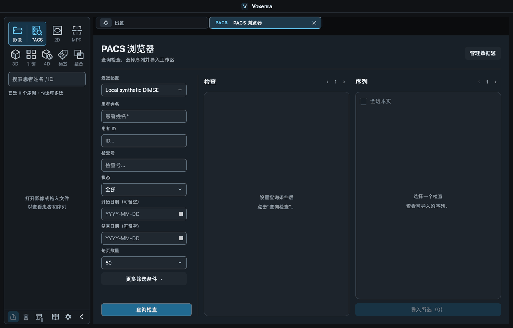](docs/screenshots/51-dimse-settings.png)

原生界面演示，使用本机真实 DIMSE 服务和合成 DICOM 数据。C-ECHO 成功只代表连接测试通过；查询权限与回传链路需通过实际序列导入验证。当前 DIMSE 不含 C-GET、DICOM TLS、上传或常驻接收服务，具体部署条件见 [PACS 配置](docs/pacs.md) 与 [实际联调范围](docs/validation/dicom-dimse.md)。

## 本地 AI 自动分割 · TotalSegmentator

从 CT 阅片到器官分割，在同一工作区中完成：

- **按需选择器官**：在 CT 的 MPR / 4D 中搜索、勾选模型支持的结构，默认肝脏、脾脏和双肾。
- **本机推理**：连接已有 TotalSegmentator 环境，计算当前时相的完整 CT；支持按环境选择 CUDA、Apple MPS 或 CPU。
- **结果继续编辑**：三平面叠加查看，画笔／橡皮精修、显隐、撤销；随工作区保存，或导出 SEG / NRRD。

[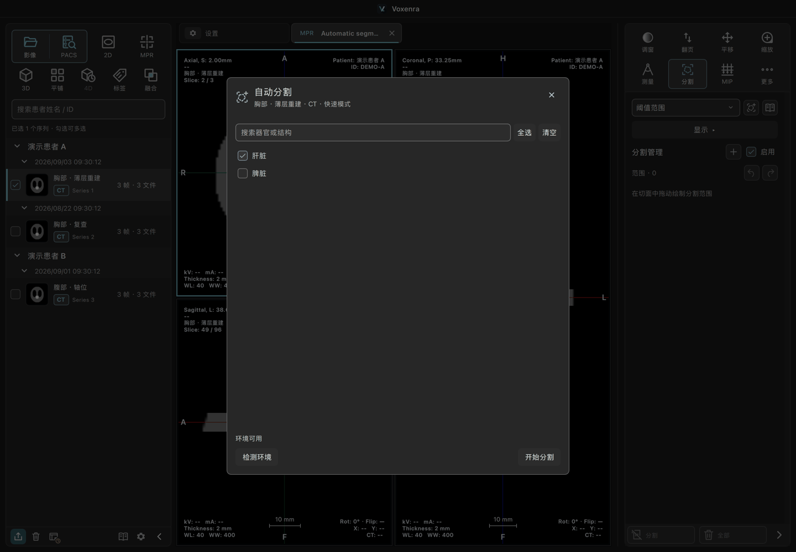](docs/screenshots/48-ai-complete-2.1.1.png)

当前应用的合成模体流程演示，模拟推理输出以展示选择、失败重试和成功导入；不代表模型精度或计算耗时。需另行安装 TotalSegmentator 和 CT 快速模型；在 **设置 → AI** 检测环境。自动结果可核查和精修。

[配置与使用教程](https://l5769389.github.io/voxenra/zh/segmentation.html) · [TotalSegmentator 项目](https://github.com/wasserth/TotalSegmentator)

## 二维阅片与序列对比

原始切片与轴位／冠状位／矢状位重建可在视口内切换，各自保留位置和显示状态。CT / MR 支持调窗与反白，PET 使用定量显示范围；布局支持序列拖放、最多 6 × 6 网格和双击放大。

**2–4 序列对比**可逐项同步翻页、调窗、缩放等操作，重新开启同步时以当前选中视口为准。兼容的患者空间支持位置联动、定位线及 Alt＋单击定位；也可按相对进度比较不同层数。MR 默认独立调窗／反白。空间联动与进度对应均不执行自动配准。

<table>
<tr>
<td width="50%"><b>MR 阅片</b><br><a href="docs/screenshots/07-mr-reading.png">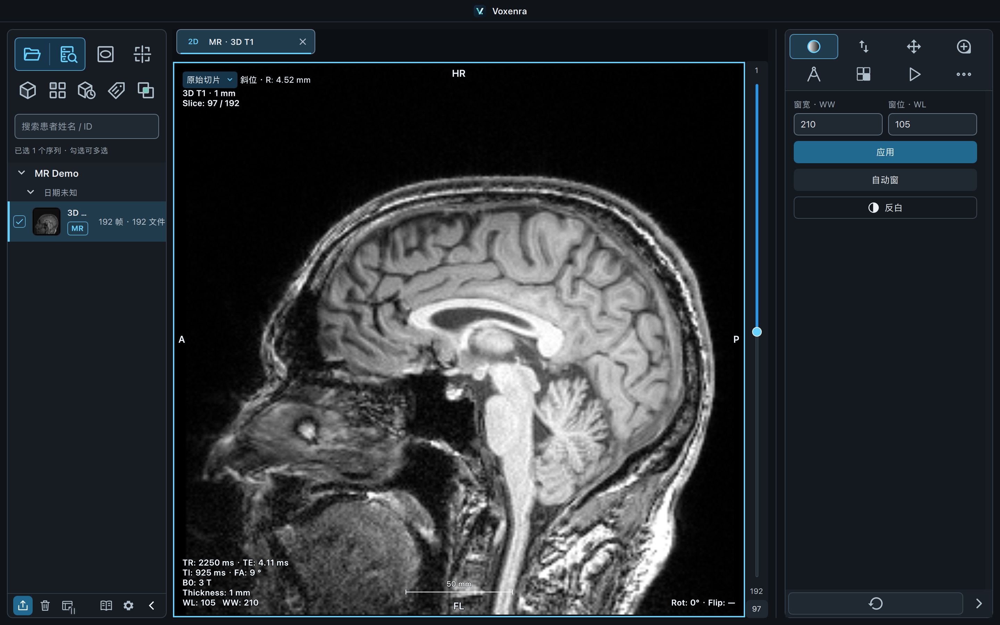</a></td>
<td width="50%"><b>自定义多视口</b><br><a href="docs/screenshots/10-2d-layout.png">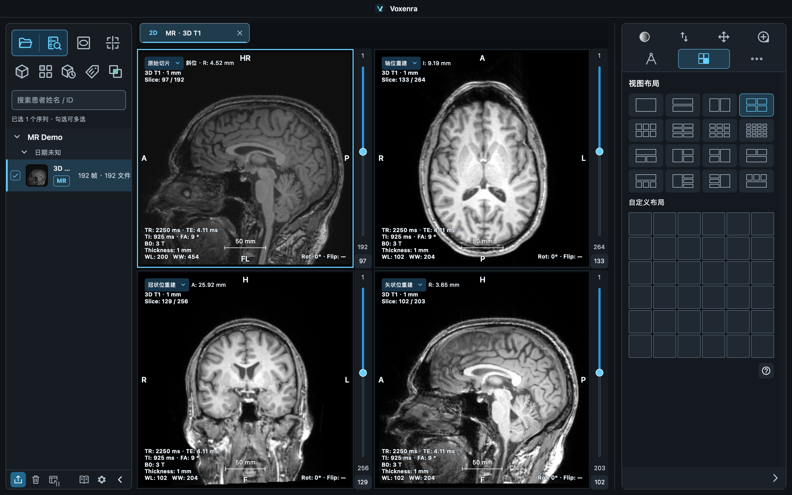</a></td>
</tr>
</table>

### 辨识影像、收藏窗模板与专注阅片

页签第一行优先显示原始序列描述，第二行显示患者与有效检查信息；缺失字段不占位，悬停查看完整来源。身份隐藏设置同时覆盖新增的阅片身份信息。窗值统一按 **WW → WL** 显示；CT 模板可星标收藏并优先排列，点击星标不改变当前窗值，模板列表独立滚动。

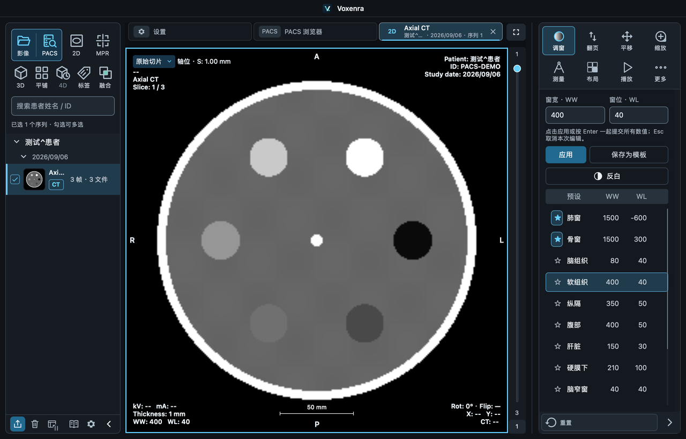

点击页签栏右端的 **最大化视图区**，或按 **F12**（部分 Mac 键盘需 Fn+F12），同时隐藏左右面板和按钮栏；再次操作恢复原宽度与展开状态。此状态仅作用于当前窗口，与双击放大单个视口、系统全屏各自独立。

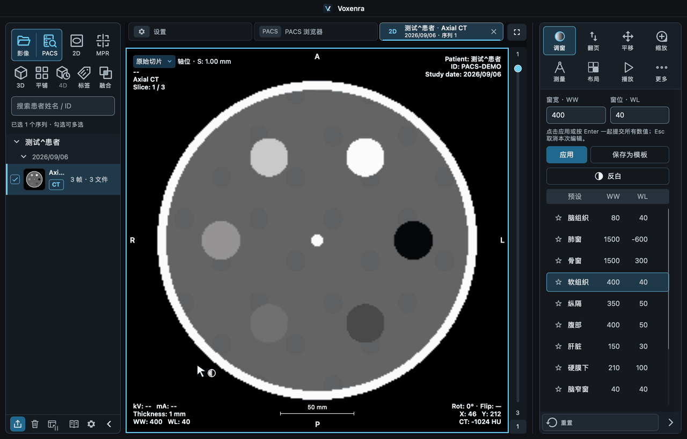

## MPR、3D 与 4D

- **MPR**：轴位、冠状位、矢状位联动，支持斜面重建、七种布局及 MIP / MinIP / Mean / Sum 厚层投影；四宫格可显示 3D 空间参考并联动旋转。
- **3D**：CT、MR、PET 体绘制，支持模板、调窗、方向、旋转和圈选裁剪；CT 提供 20 个模板及去床板。
- **4D**：CT 多时相同步播放，分割和 VOI 按时相保存；可独立播放当前时相切片。

**双序列 MPR 对比**提供常驻的位置、旋转、CT 调窗与物理显示比例开关，默认独立操作。开启调窗／比例同步以当前组为准；位置／旋转同步保留原有偏移并同步后续操作。双击切面可并排放大对应平面，联动不执行自动配准。

**MPR 布局切换**：三平面与 3D 同屏，可调整布局、放大单个视图并记住布局。

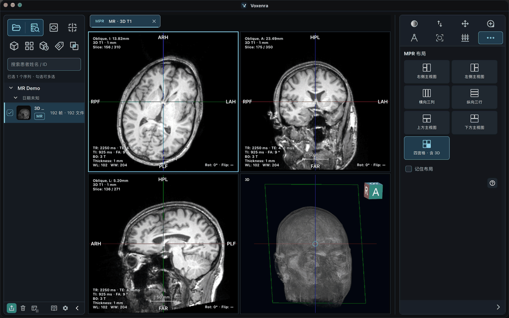

<table>
<tr>
<td width="50%"><b>斜面重建</b><br><a href="docs/screenshots/14-oblique-mpr.png">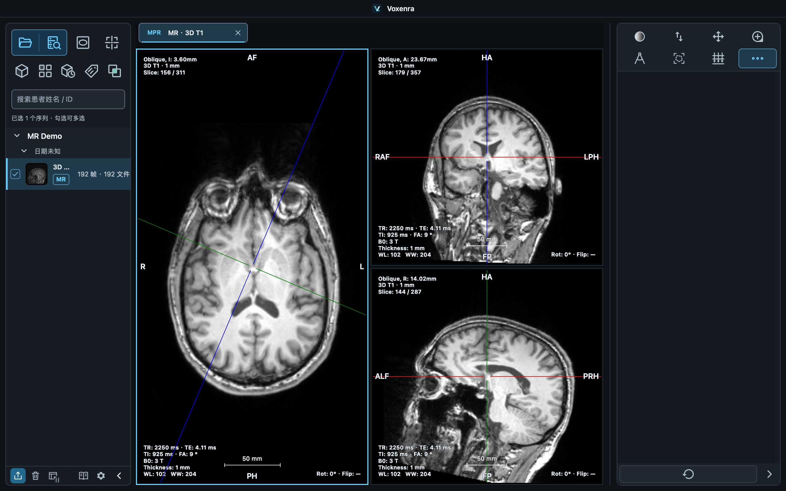</a></td>
<td width="50%"><b>双序列 MPR 对比</b><br><a href="docs/screenshots/09-mpr-compare.png">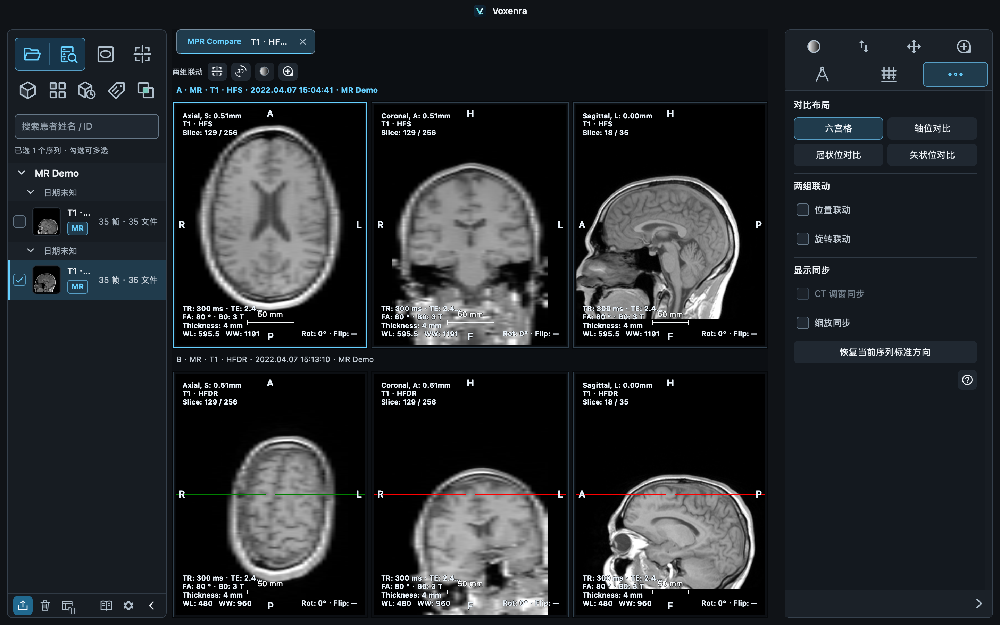</a></td>
</tr>
</table>

**3D 模板与旋转**

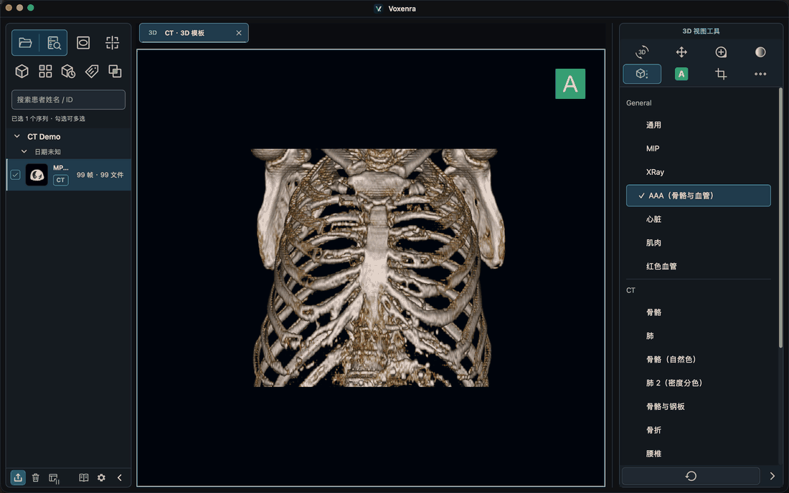

**4D 多时相播放**

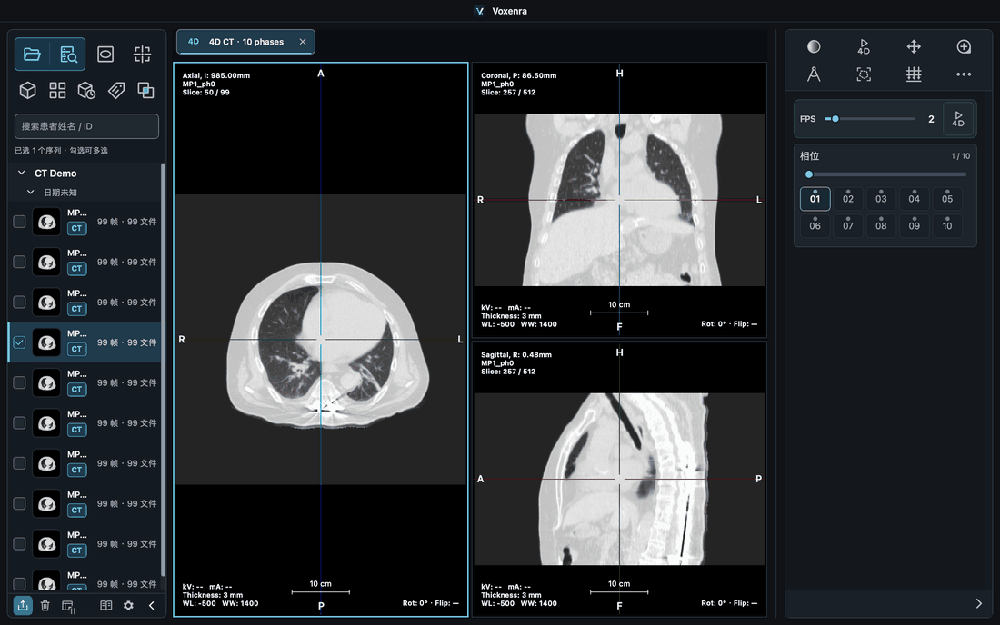

## PET/CT 融合

CT、PET、融合切面与全体积 MIP 联动显示；可切换三向切面、调整色表与融合比例，进行手动刚性配准。PET 按元数据提供 SUV 或源活度单位；切面中的 VOI／阈值分割使用原始定量数据。融合 3D 可分别控制 CT 与 PET 的显示。

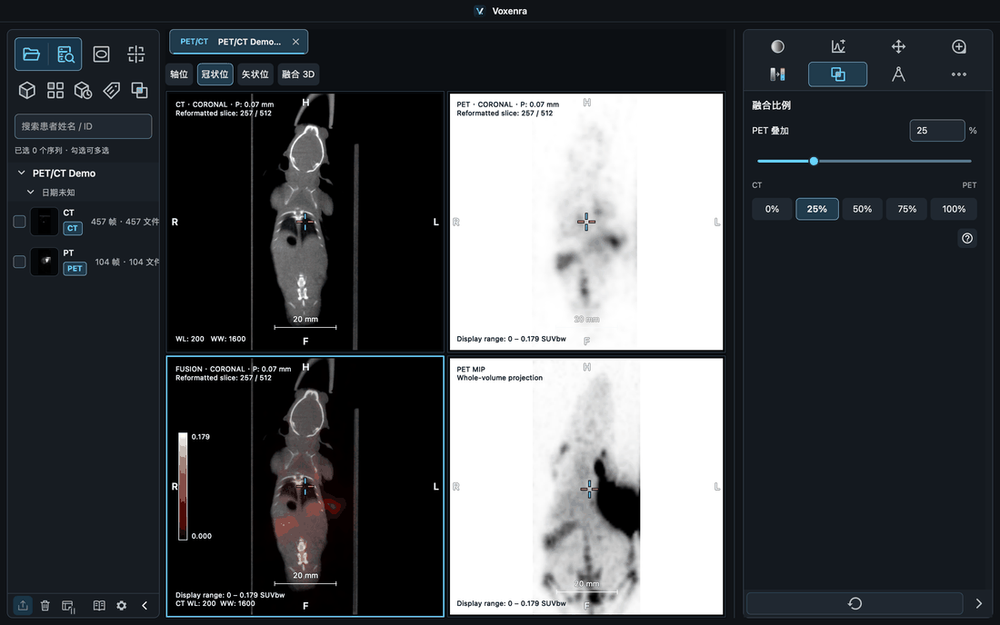

<table>
<tr>
<td width="50%"><b>二维融合</b><br><a href="docs/screenshots/05-pet-ct-fusion.png">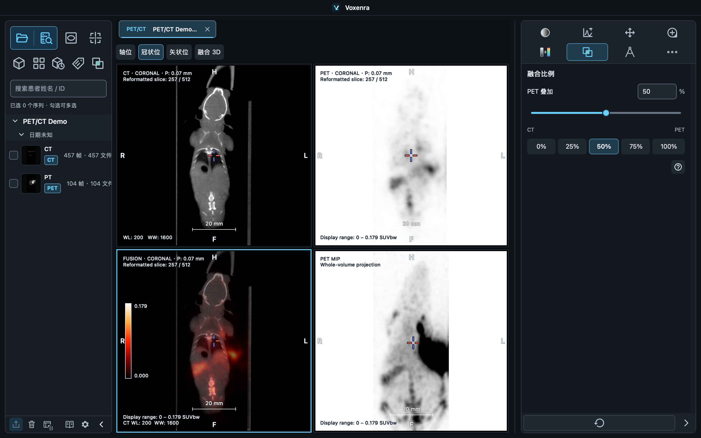</a></td>
<td width="50%"><b>三维融合</b><br><a href="docs/screenshots/06-fusion-3d.png">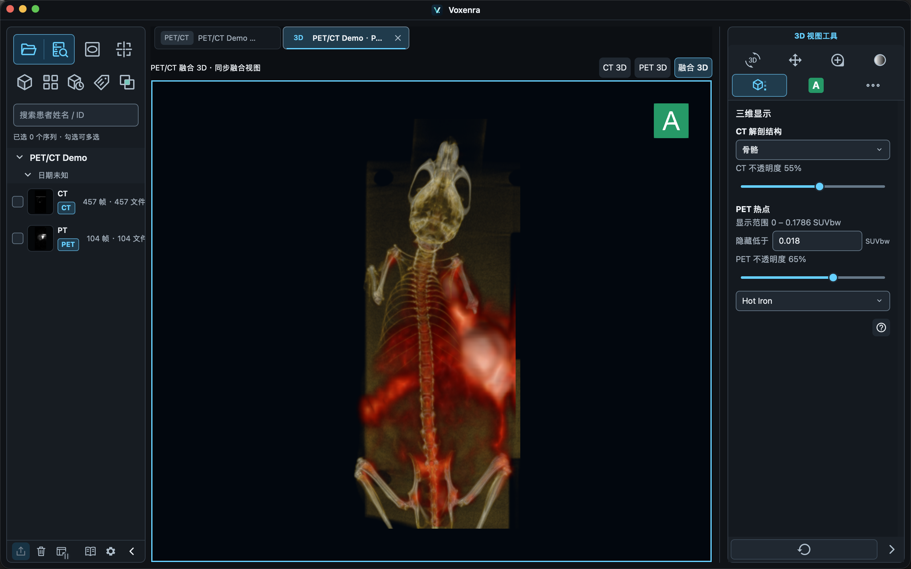</a></td>
</tr>
</table>

## 测量、分割与报告

- **测量与标注**：长度、角度、曲线、矩形／椭圆／自由形状 ROI，提供面积、周长和强度统计；支持文字／箭头、列表定位、重命名、显隐、锁定、复制粘贴与撤销重做。
- **分割与 VOI**：CT/PET 阈值分割和球形／椭球 VOI；CT/MR/PET 掩膜可用画笔／橡皮精修、连通区域保留或删除。支持自由形状 ROI 转单层分割、轮廓／填充、不透明度、区域管理和撤销重做。
- **结果**：测量导出 CSV / PDF 或 DICOM SR，PDF 自动匹配测量所在平面的参考图；分割支持 DICOM SEG 和 NRRD / Slicer 往返交换，保留重叠区域、名称与颜色。

**自由形状测量**：逐点点击添加控制点，生成平滑闭合轮廓并统计。

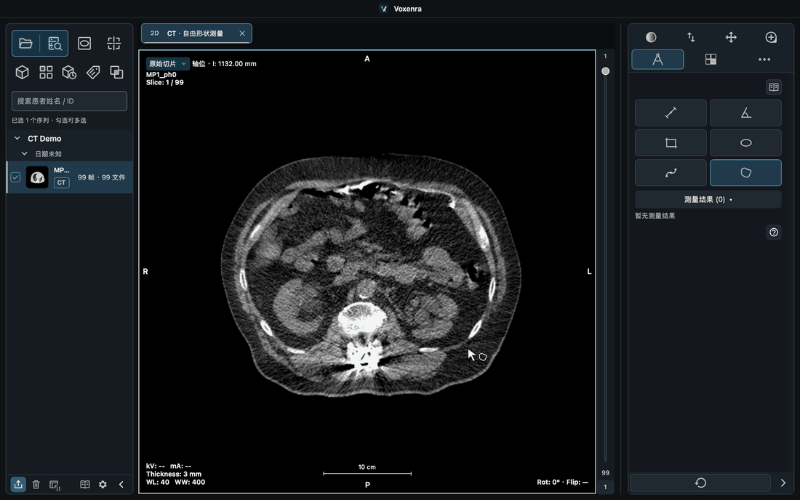

**曲线测量**：少量控制点确定平滑路径，测量实际弧长。

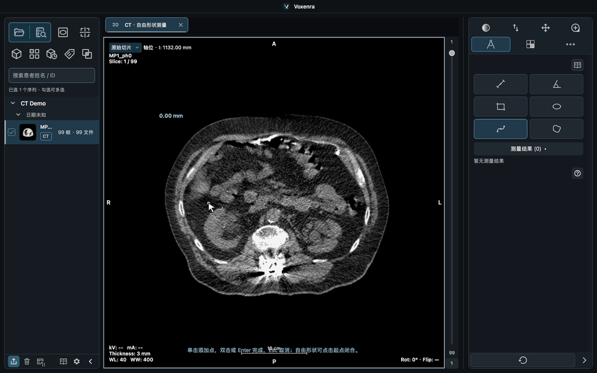

**分割精修**：毫米或相对视图尺寸的画笔与橡皮，支持当前切面或 3D 球形范围。

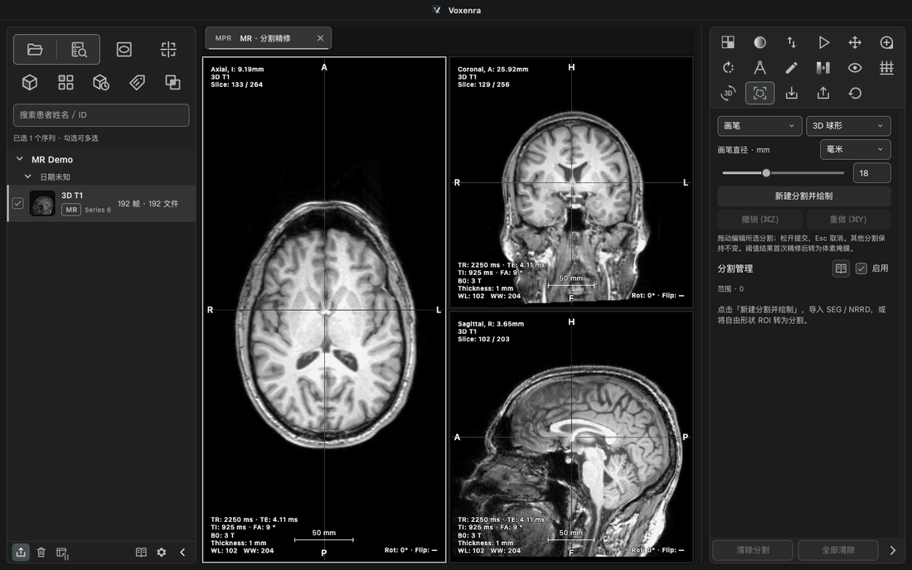

<table>
<tr>
<td width="50%"><b>关联结果导入</b><br><a href="docs/screenshots/33-associated-import.png">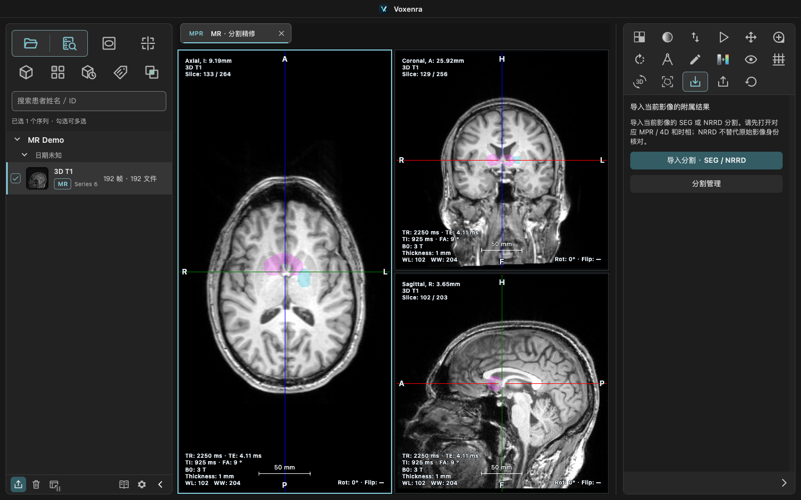</a></td>
<td width="50%"><b>分割与报告导出</b><br><a href="docs/screenshots/32-structured-report.png">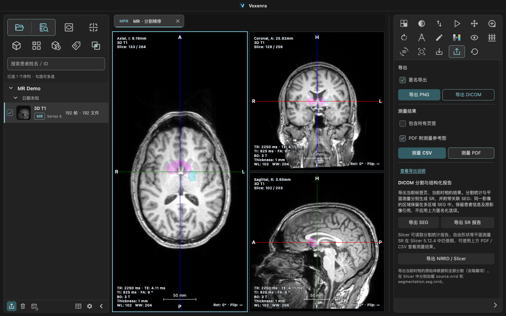</a></td>
</tr>
</table>

### CT 质量分析

- **QA**：水模 CT 值、噪声和均匀性；未识别到可用水模时提供五个可编辑圆形 ROI 及取样统计。初始 ROI 与副本均可移动、复制、删除、重新生成、撤销重做；仅在满足条件时显示水模五点汇总。
- **MTF / FWHM**：点源 MTF 曲线与空间分辨率，斜坡线 FWHM 和层厚分析；正式结果、ROI 与参数可随工作区保存。

<table>
<tr>
<td width="50%"><b>CT 水模 QA</b><br><a href="docs/screenshots/19-water-qa-2.1.3.png">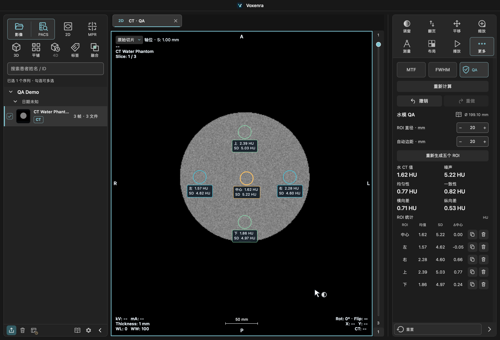</a></td>
<td width="50%"><b>点源 MTF</b><br><a href="docs/screenshots/28-mtf-analysis.png">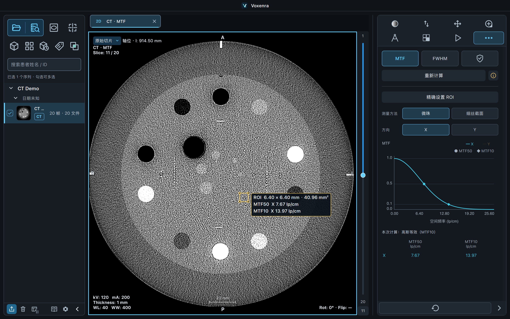</a></td>
</tr>
</table>

## 数据管理与工作区

左侧导入原始 DICOM 影像，右侧 **导入分割** 导入关联 SEG / NRRD 掩膜（v2.1.3 中名为“导入”）。源序列可导出 PNG 或 DICOM，当前视图可保存 PNG 截图；整序列导出与视口截图的内容范围不同，见 [导出说明](docs/export.md)。

多页签可拖出成为独立窗口；工作区保存影像引用、布局、测量、分割掩膜与分析结果，并恢复之前选择的工具和精修参数。可新建空白工作区；关闭页签保留编辑结果，可从工作区入口或 Ctrl+Shift+T／⇧⌘T 重开，退出时统一确认保存。工作区保存影像引用和结果，仍需保留原始文件；未完成草稿与撤销历史不保存。支持自动恢复、深色／中性深灰／浅色主题、本地 JSON 语言包与窗模板、离线手册、反馈和可关闭的启动更新检查。离线手册包含可播放、暂停和放大的操作动图。

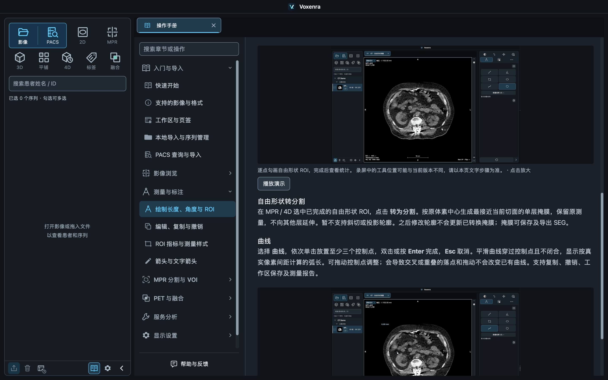

<table>
<tr>
<td width="50%"><b>导入后工作区</b><br><a href="docs/screenshots/45-workspace-home-2.1.3.png">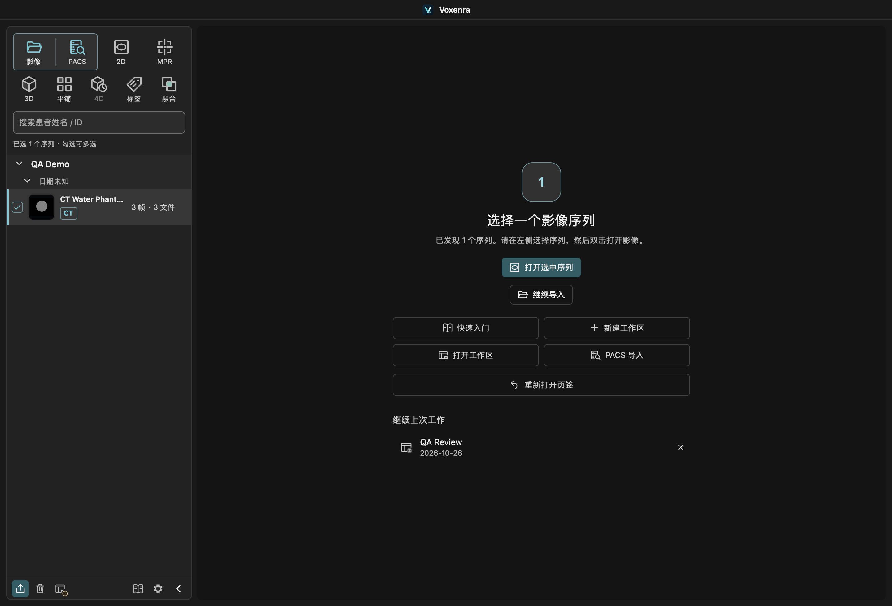</a></td>
<td width="50%"><b>PACS 浏览器</b><br><a href="docs/screenshots/16-pacs-browser.png">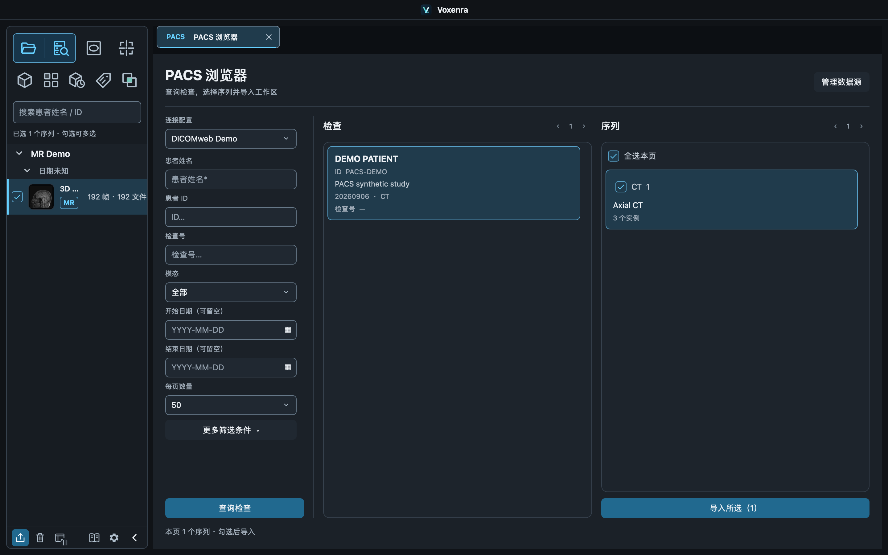</a></td>
</tr>
<tr>
<td><b>独立窗口</b><br><a href="docs/screenshots/13-detached-tabs.png">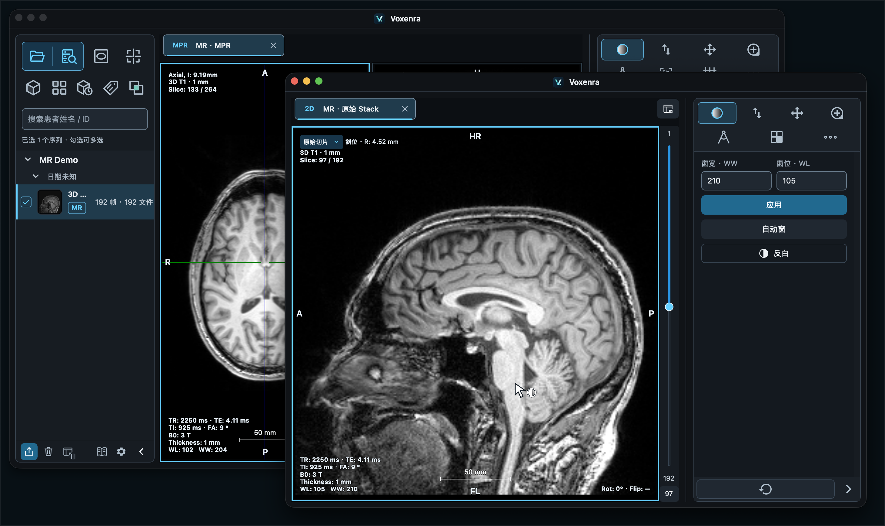</a></td>
<td><b>工作区恢复</b><br><a href="docs/screenshots/17-workspace-2.1.3.png">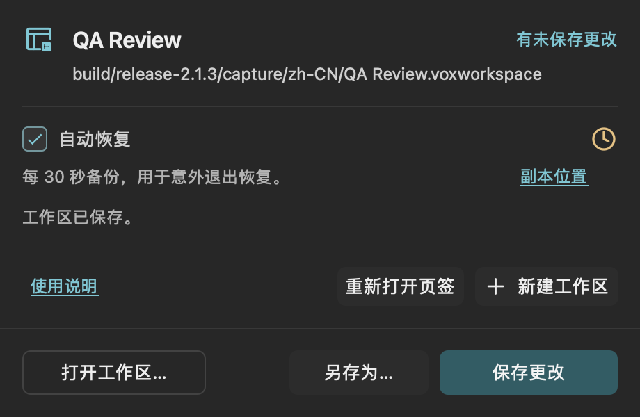</a></td>
</tr>
</table>

## 外观与操作偏好

在 **设置 → 外观与语言** 中选择 **深色、中性深灰或浅色**。中性深灰采用石墨灰面板与低饱和青色强调，保持影像区域突出。主题即时生效并在重启后保留，影像窗宽窗位与色表独立设置。

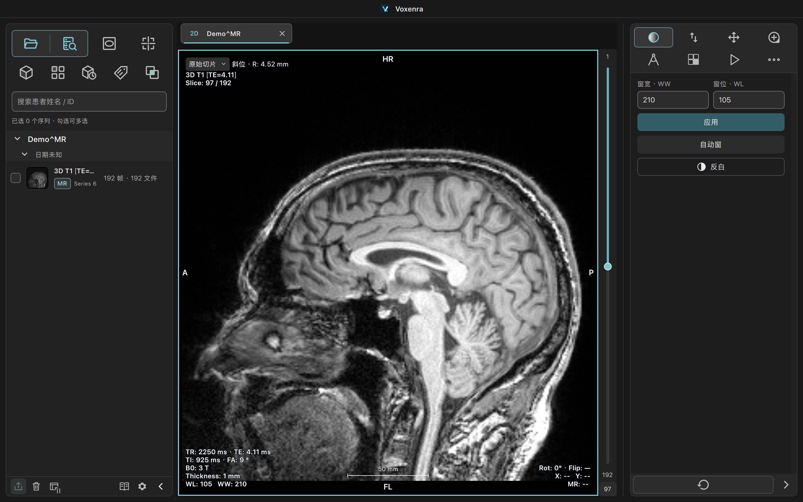

[深色主题](docs/screenshots/25-theme-dark.png) · [浅色主题](docs/screenshots/26-theme-light.png)

可设置界面大小、鼠标拖动、滚轮方向与工具快捷键，重复或保留按键会被拦截。四角字段及顺序、十字线、比例尺、测量样式和 ROI 指标也可配置。内置中文、英文与巴西葡萄牙语，并支持添加本地 JSON 语言包。左侧栏操作与右侧工具说明文字可独立开关。隐私设置支持新视图隐藏身份叠加、清除最近工作区记录。

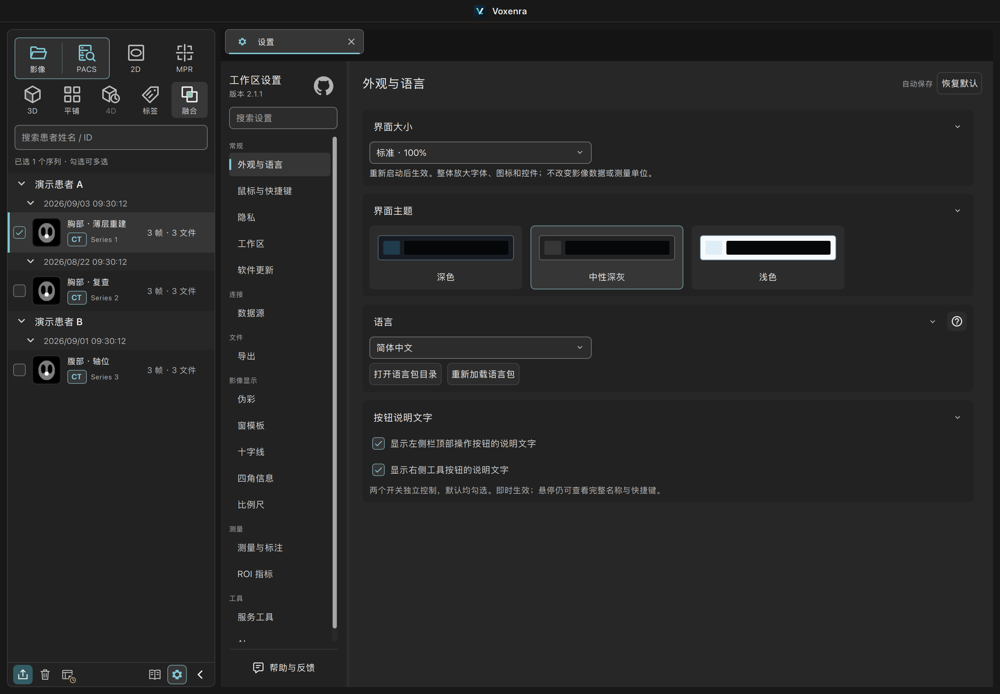

[鼠标操作与工具快捷键设置](docs/screenshots/40-input-settings.png)

### 按阅片任务组织工具栏

在 **设置 → 工具栏** 调整左侧视图入口，以及右侧的 **常用／更多** 工具。右侧以 **2D 阅片、MPR 重建、3D、平铺、4D、融合** 六类选择，展开细分选项后按单序列／对比模式和图像类型分别配置。

直接拖动带图标的按钮排序或跨组放置，也可选中后前移、后移、转组。常用区最多 7 项；修改先保留为草稿，**保存** 后应用到所有窗口并持久保留，**取消** 放弃草稿，**恢复当前默认** 只调整当前配置。文件、PACS 与底部系统入口位置固定。

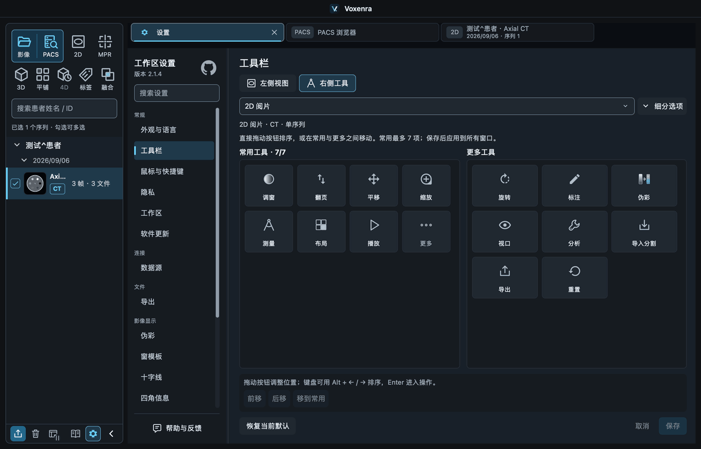

已发布安装包支持下载校验与应用内更新。更新提示按界面语言显示简短摘要，可查看完整发布说明。[更新弹窗](docs/screenshots/43-update-summary.png)

[整序列导出完成](docs/screenshots/46-export-complete-2.1.1.png) · [自动分割失败与重试](docs/screenshots/47-ai-error-2.1.1.png)

[查看完整界面图集](docs/screenshots/README.md)

## 支持范围

- 支持常规 CT / MR、经典静态／全身 PET、Enhanced CT / MR，以及 RLE、JPEG、JPEG-LS、JPEG 2000 像素解码。MPR / 3D 需要规则空间采样，PET 定量取决于影像元数据；Enhanced CT 时相按组浏览，暂不接入 4D。
- 常见 RGB、YBR 与 PALETTE COLOR DICOM 支持二维、平铺、多帧播放及 PNG 导出；物理尺寸测量需要有效像素间距，不开放彩色 MPR / 3D 或 HU 分析。
- NRRD 支持当前时相体数据导出，以及匹配原始网格的分割导入导出；暂不提供独立 NRRD 影像浏览或自动重采样。
- 暂不支持 NIfTI、动态／门控／Enhanced PET、MR 4D、fMRI / DTI 分析，以及 SR / RTSTRUCT 导入。
- SEG / SR 保留源身份与影像引用，不使用 PNG / 普通 DICOM 导出的匿名选项；匿名导出也不会擦除像素内烧录文字。

## 文档与运行

[在线操作手册](https://l5769389.github.io/voxenra/zh/) · [影像支持](docs/image-support.md) · [本地导入](docs/local-import.md) · [PACS](docs/pacs.md) · [PET 与融合](docs/pet-mpr-fusion.md) · [分割与 VOI](docs/mpr-segmentation-voi.md) · [导出](docs/export.md) · [离线手册说明](docs/manual.md) · [开发与打包](docs/packaging.md)

```bash
uv run voxenra
```
