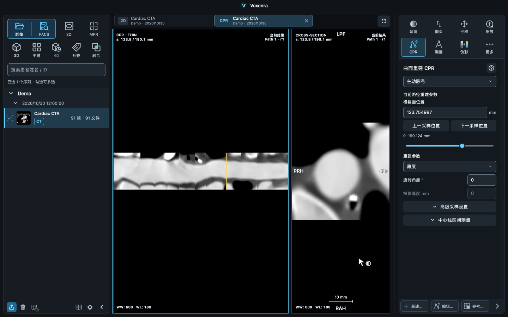
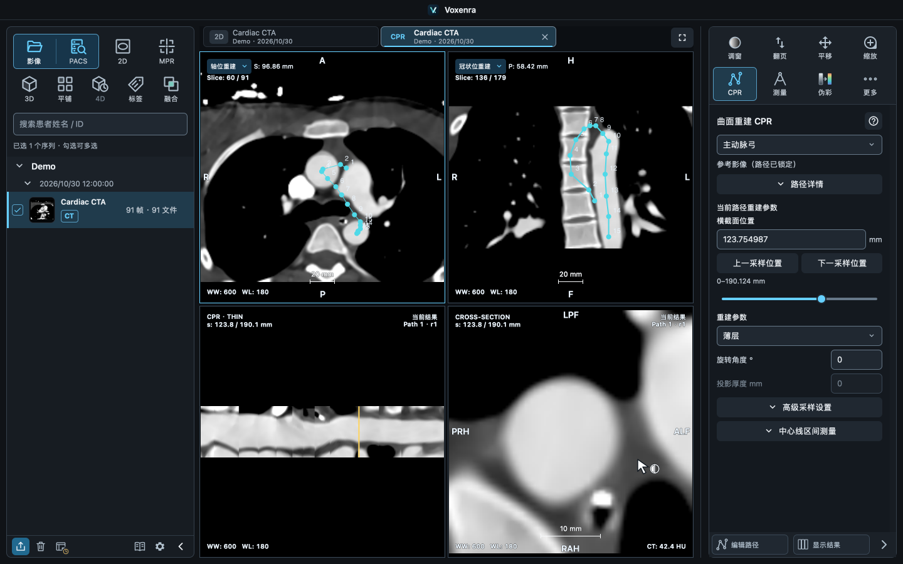

# 离线操作手册

网站首页：[简体中文](https://l5769389.github.io/voxenra/) · [English](https://l5769389.github.io/voxenra/en-us/)。操作手册：[简体中文](https://l5769389.github.io/voxenra/zh/) · [English](https://l5769389.github.io/voxenra/en/)。手册由下述章节与语言包自动生成；应用内手册继续离线可用。

点击左下角书本图标打开手册，无需导入影像。右侧测量、分割、VOI、QA、导出等面板的帮助入口直接进入对应章节；工作区窗口的「使用说明」也可直达。

## 阅读方式

- 在 **设置 → 外观与语言** 选择简体中文或 English，手册的目录、正文、搜索、截图和语言包动画同步切换。

- 正文、标题和截图说明可选中，使用 **⌘C / Ctrl+C** 或右键菜单复制。

- **先看摘要和截图，再按步骤操作**。软件截图使用合成影像或匿名展示记录，不显示患者身份信息；点击可放大，选择「原始大小」查看细节，按 Esc 或系统关闭按钮返回。
- **操作动图离线可用**：默认显示静态预览，点击「播放演示」开始，点击「停止演示」恢复预览；点击画面可放大。切换章节或离开手册时停止播放。旧录屏的工具位置可能与当前版本不同，以页面文字步骤为准。
- **蓝色快捷键标签**按平台显示，macOS 使用 ⌘ / ⇧ / ⌃，Windows 使用 Ctrl 等键名。影像编辑快捷键需让影像获得焦点；输入框内只编辑文字。
- **加粗文字**标出按钮名称、操作顺序和关键数值；浅色提示块说明保存、匿名和定量等重要边界。
- 目录按 8 类折叠，点击带图标的分类标题展开或收起。打开帮助时会自动展开当前章节所在分类；搜索时展开所有匹配项，清空搜索后恢复折叠状态。
- 目录默认宽度 **260 像素**，可拖动中间分割线调整为 **220–400 像素**，重启后保留；窄窗口会自动保留正文空间。目录字号为 14 像素，正文为 14 像素。
- 左侧可搜索章节、正文和快捷键；章节底部的相关链接连接相邻任务。旧帮助入口会跳到合并后的对应小节。
- 切换页签保留阅读位置和影像操作。已打开手册复用同一页签；关闭后重新打开从快速开始进入。

## 外观主题

在 **设置 → 外观与语言** 选择深色、中性深灰或浅色：深色为蓝灰面板，中性深灰为石墨灰面板，浅色为明亮面板。切换立即生效，保留阅片位置和测量结果，重启后仍使用所选主题。主题不调整影像窗宽窗位、色表或测量颜色。

三种主题的完整应用截图见 [主页外观介绍](https://l5769389.github.io/voxenra/#appearance)。具体操作说明与中英文译文由手册的「设置与恢复默认 → 外观与语言」小节统一维护。

在语言选项下方的 **按钮说明文字** 中，可分别设置左侧顶部操作按钮和右侧工具按钮的文字，两项默认开启。右侧设置也适用于收起的工具栏和工具选项；悬停仍可查看完整名称与快捷键。两个开关独立、即时生效，重启后保留。

## 工具栏布局、专注阅片与常用窗模板

在 **设置 → 工具栏** 直接拖动带图标的按钮，看到插入标记后松开即可调整位置；右侧按钮也可在 **常用** 与 **更多** 之间拖动，常用最多 7 项。也可选中按钮后使用 **前移／后移**、转组按钮或 **Alt + ← / →**。拖动时按 **Esc** 取消。

编辑区直接显示排列效果，确认后点击 **保存**；**取消** 放弃草稿，**恢复当前默认** 也需保存后生效。排序在重启后保留，不改变实际工具栏的按钮说明文字开关。

右侧工具按 **2D 阅片、MPR 重建、3D、平铺、4D、融合** 六类选择。初次打开时定位到本窗口最近使用的影像配置；展开 **细分选项** 可切换单序列／序列对比及图像类型。当前完整配置名称始终显示，**保存只影响修改过的具体配置**，其他类型的排序保持不变。PET/CT 三维位于 **3D** 分类。

**编辑后先保存，再离开工具栏设置页。** 关闭或离开该页会结束当前草稿。影像和 PACS 导入入口、底部系统按钮的位置固定。


点击页签栏右端的 **最大化视图区**，或按 **F12**（部分 Mac 键盘需 **Fn+F12**），可同时隐藏左右侧栏。再次操作恢复原来的宽度和展开状态，保留影像和编辑结果。它与系统全屏独立。


窗模板名称旁的 **☆／★** 用于收藏或取消收藏。收藏项优先显示，**点击星标不会应用窗值**；点击模板名称才应用。也可在 **设置 → 窗模板** 管理收藏。滚轮只滚动模板列表，数值输入和操作按钮保持原位。

[查看窗模板收藏截图](screenshots/55-window-favorites.png)

## PACS：DICOMweb 与传统 DICOM

在 **设置 → 数据源** 新增连接，按服务器提供的信息选择 **DICOMweb** 或 **传统 DICOM（DIMSE）**。配置后统一使用 **PACS → 查询检查 → 选择检查 → 勾选序列 → 导入所选** 的流程。

DIMSE 除 PACS 主机、端口和远端 AE 外，还需要本机接收 AE、监听 IPv4 和接收端口。**请管理员先在 PACS 登记本机接收节点；C-ECHO 成功不代表回传链路已通。** 保存后用一个小序列验证查询和导入。完整字段说明及失败排查见 [PACS 配置](pacs.md)。


以上新增截图和动图来自实际应用，使用本机 DIMSE 对端与三实例合成 CT 模体；画面中的回环地址、临时端口仅用于演示。离线手册内的演示均默认静止，点击后播放。

## 数值输入与恢复默认

窗模板列表中的 **☆ / ★** 用于收藏和取消收藏，设置中的窗模板页面同步管理。收藏模板优先显示，收藏操作不会改变当前影像窗值；点击模板名称才应用。鼠标位于模板列表时，滚动只作用于列表，上方输入和操作区域保持原位。

独立数值输入框按 **Enter** 或失焦后提交合法值；**Esc** 取消编辑并恢复当前值。无效输入在提交时恢复，滑块、开关与选项即时生效。

**CT 窗宽／窗位、标量显示最小／最大值、PET 配准参数**先编辑整组，再点击 **应用** 或按 **Enter** 一次提交；失焦不提交，**Esc** 取消整组草稿。切换操作对象或退出面板会丢弃尚未应用的输入。窗模板的名称与窗值、PACS 连接表单点击 **添加／保存** 或按 **Enter** 整体提交，**Esc** 取消编辑。

设置中的 **恢复默认** 先提示当前分类的影响，确认后执行；取消或按 **Esc** 不作修改。窗模板的确认提示明确列出将删除的自定义模板数量，并说明**删除不可撤销**。恢复只作用于当前分类。

## 视口鼠标操作

点击页签栏右端的 **最大化视图区** 隐藏左右两侧面板及按钮栏，点击 **还原视图区** 恢复原布局。快捷键 **F12**（部分 Mac 键盘需 **Fn+F12**）；仅作用于当前窗口，与全屏独立，不改变影像或编辑结果，重启不保留最大化状态。

页签上行显示患者和原始序列描述，下行优先显示检查日期与序列号；悬停查看完整来源信息。长名称只做视觉省略，不改写 DICOM 内容。窗宽窗位的人工可读显示顺序统一为 **WW → WL**。

默认左键拖动调窗，右键拖动缩放，滚轮翻页。选中的平移、测量、标注等工具优先使用左键；十字线、定位点、VOI／分割控制点沿用已有左键交互。右键缩放不切换所选工具，也保留未完成的测量。

点击 **旋转** 后，按住左键围绕影像中心拖动，可按任意角度旋转画面。**顺时针 90°／逆时针 90°** 和镜像子项每点击一次执行一次，之后仍可继续拖动旋转。MPR 中只调整当前视图的显示方向，十字线和标注随画面一起转动，不改变重建切面；选择其他工具后恢复十字线操作。**重置旋转** 恢复画面方向和镜像，不重置 MPR 切面。角度随工作区保存。

融合手动配准时，PET／FUSION 视口左键平移、右键旋转优先。3D 左键执行当前工具（默认旋转），右键拖动及滚轮缩放；体绘制没有切片页。平铺的滚轮仍用于浏览序列网格。

## 内容范围

PACS 支持 **DICOMweb** 与 **传统 DICOM（DIMSE）**，在 **设置 → 数据源** 选择协议。传统 DICOM 需要 PACS 端登记本机接收 AE、IP 和端口；连接测试成功后，还需实际查询和导入验证回传。字段及故障排查见软件内 **PACS 查询与导入**，详细配置见 [PACS 连接说明](pacs.md)。

| 分类 | 主要内容 |
| --- | --- |
| 快速开始 | 支持的影像与格式、混合导入、PACS、序列管理、页签、工作区保存与恢复 |
| 影像浏览 | CT / MR / PET 2D、MR 基础阅片、MPR、CT / MR 平铺、CT 4D、CT / MR / PET 三维与裁剪 |
| 测量与标注 | 绘制、完成与编辑、复制粘贴、撤销重做、ROI 统计与样式、测量结果列表与定位 |
| MPR 分割与 VOI | 范围、阈值、深度、CT/PET 单位及范围管理 |
| PET 与融合 | 独立 PET、CT/PET 配对、联动与手动配准 |
| 服务分析 | MTF、斜坡线 FWHM、单层水模 QA、结果保存与重新计算 |
| 显示设置 | 外观与语言、新增语言包（含中英文动画）、伪彩、窗模板、十字线、四角信息、比例尺 |
| 导出与常见问题 | PNG、DICOM、测量 CSV/PDF 与自动配图、匿名范围及结果文件定位 |

包含「支持的影像与格式」与「MR 基础阅片」在内共 31 个章节。详细的实现和文件语义另见 [本地导入](local-import.md)、[工作区与测量结果](workspaces.md)、[导出](export.md)。手册只说明已经支持的能力。

## 维护

目录清单及旧入口映射在 `src/qt_dicom_viewer/qml/assets/help/manual.json`，正文按 8 个分类拆分到同级 `chapters/*.json`。页签与工作区、2D/MPR 对比、ROI 与测量样式、分割编辑与范围管理、PET 显示与定量、视口叠加显示已合并，避免细碎章节和重复说明。

维护约定：

- `messageId` 保留合并前的翻译标识，已有用户语言包仍可覆盖对应文案；分类与章节的 `icon` 复用应用图标。
- `summary` 用一句话说明用途；`sections` 每段只讲一个操作，使用 `**重点**` 或行内反引号强调，换行用于并列指标。任意 HTML 作为普通文字显示。
- `shortcuts` 分别给出 Windows/Linux 和 macOS 键名；必须与软件实际快捷键核对。
- `important` 只用于会改变操作含义的重要提示；`related` 使用现有章节 ID，保留各工具帮助的跳转目标。
- `example` / `examples` 与 `caption` 绑定实际软件截图或 GIF 操作动画，CT/PET 可切换；不要用设计稿替代已经实现的界面。
- 几何示意保留在 `figure`，交互光标图例由 `cursorLegend` 控制。

`ui/manual_content.py` 负责分文件加载与富文本，`ManualTabController` 管理搜索、折叠、跳转和阅读位置；`ManualNavigation.qml` 提供目录，`OperationManual.qml` 排版和调整宽度，`ManualScreenshot.qml` 提供原生截图窗口。所有内容、图片和 QML 均列入 `Voxenra.qrc`，随应用离线打包。

## 更新截图与验证

在原生桌面运行，配置及影像全部位于临时目录：

```sh
QT_QPA_PLATFORM=cocoa QT_QUICK_BACKEND=software PYTHONPATH=src:tests \
  python tests/manual/capture_manual.py /tmp/manual-screenshots
```

Windows 使用 `QT_QPA_PLATFORM=windows`，通过环境变量设置 `PYTHONPATH`。截图先输出到独立目录，人工检查后再更新 `qml/assets/help/`，只捕获本软件窗口。原生 3D 使用窗口截图 API 以包含 VTK 子窗口。

`tests/test_manual.py` 覆盖文本转义、重点样式、快捷键搜索、截图放大、相关链接、全部章节布局、阅读位置、单例页签，以及测量/分割和三维控制器状态保留。原生窗口及高 DPI 截图需额外检查，不能仅用离屏测试替代。

## 序列 MPR 对比

### 打开六宫格

在左侧勾选两组可重建的序列，右键选择 **序列 MPR 对比**；也可右键一组，在弹窗中选择另一组。两组都需要可构建规则体数据的影像。页签标识为 **MPR Compare**；上排为 A，下排为 B，每排依次为 Axial、Coronal、Sagittal。

### 独立操作与对应切面放大

点击任一切面激活视口，右侧工具随当前组切换。两组默认独立定位、旋转、调窗、缩放和平移；同组的三个切面共享空间定位，CT／MR 窗值在组内同步。双击切面可并排放大两组的对应切面，再次双击返回六宫格，也可在右侧第一个 **布局** 工具中切换。

### 位置与旋转联动

在 **布局** 面板分别勾选 **位置联动**、**旋转联动**，两项默认开启。先分别定位，开启时不会跳转或对齐影像；开启后任一组的后续位移（患者坐标毫米）或旋转操作同步到另一组，保留原有相对偏移。关闭后立即恢复独立操作。此功能**不自动配准**，联动不代表解剖位置已匹配。

### 独立测量与工作区恢复

每个切面的测量和标注各自独立，支持撤销、重做及复制粘贴；报告按来源序列保留结果。保存工作区会保留两组影像引用、三平面位置与方向、显示状态、测量标注、当前视口、放大布局及联动开关。恢复时需要原始影像仍可访问。

### 常驻联动状态与显示同步

对比区域顶部始终显示位置、旋转、CT 调窗和物理比例四个开关，收起右侧工具栏后仍可查看或切换。高亮表示开启，悬停查看状态；也可在布局面板设置。调窗同步仅适用于两组 CT，开启时采用当前选中序列的 WW / WL，各自保留反白设置。物理比例同步在对应切面之间匹配毫米显示比例，数值倍率可以不同；改变布局或窗口大小后继续保持比例一致。四项开关默认关闭，并随工作区保存。

### 超出影像范围

当有限切面或厚层范围与本序列体数据不相交时，显示 **超出影像范围**。判断依据几何关系，正常的黑色背景不会触发提示。可继续移动十字线，或点击 **返回本序列中心**；返回仅移动这一组，保留另一组位置及联动开关。

## MPR 布局与空间参考

MPR 右侧第一个「布局」按钮提供七种布局：横向三列、纵向三行、左右主视图、上下主视图及包含 3D 的四宫格。CT、MR、独立 PET MPR 和 CT 4D 支持全部七种布局；融合布局保持现状。切换保留定位、窗值、测量和标注。

四宫格的 3D 复用当前时相体数据，以三色切面边框和青色交点圆环提供空间参考。边框颜色跟随十字线设置；它表示单个切面，不表示厚层投影的全部范围。可只显示交点或隐藏参考。拖动圆环在当前观察平面中移动 MPR 交点，限制在影像体范围内。选中 3D 后，右侧工具栏提供旋转、平移、缩放、模板／PET 显示设置、六方向、导出和重置；点击切面恢复 MPR 工具。布局入口始终可用，各视口保留自己的工具选择。

偏离患者标准方向的切面会在四角位置标签显示 **Oblique**，回到标准方向后恢复 Axial、Coronal 或 Sagittal。名称根据实际切面方向更新。

默认独立旋转 3D 相机；启用「联动 3D 与 MPR 旋转」后，3D 相机和 MPR 切面方向双向同步。3D 平移、缩放保持独立。各页签的布局、参考模式、旋转开关、3D 视角及显示参数随工作区保存恢复。

## 2D 场景布局与工具窄栏

左侧收起后保留缩略图、模态标识及导出、清除、工作区、手册、设置入口。展开时可用放大的箭头切换患者和检查分组；CT / MR / PET 使用高亮标识。右键 **从列表移除** 只移除对应列表项，不删除原始文件。

右侧第一个 布局 按钮提供单视图、横排、竖排、网格与主视图布局，也可选择最多 6 × 6 的自定义网格。新增视口初始为空；将左侧序列（包括收起后的缩略图）拖入任一视口即可加载或替换，松开时只更新目标视口。同窗口拖动时按 Esc 可取消。切换到四分屏后，MTF / FWHM 标签缩为 ROI 尺寸，完整结果仍在分析面板。单击视口后，右侧工具作用于该视口。缩小布局会隐藏多余视口，再展开可恢复；双击影像可临时放大单个视口。

每个 2D 视口左上角可切换 **原始切片、轴位重建、冠状位重建、矢状位重建**。原始切片按采集方向显示，旁边标明实际方向（包括斜位）；重建切面使用当前序列的体数据，不切换源序列。重建视图旁只显示位置，避免重复方向名称。位置保留 S/I、L/R、P/A 与 mm，悬停可查看含义；它不是层厚或切片序号，缺少空间信息时显示“方向与位置未知”。所需数据不完整时会在视口内提示，仍可选择原始切片返回。各模式独立保留切片位置、窗值、缩放及测量；布局、各视口的序列和模式随工作区保存恢复。隐藏四角信息后仍可使用切换入口。

点击右侧底部复位区域旁的箭头，收成 44 像素的工具窄栏。保留当前视图可用的调窗、翻页、平移、缩放与 3D 旋转。点击 **测量、旋转、标注或伪彩**，在按钮下方展开具体操作图标；再次点击收起，切换分组自动关闭上一组。二级操作以背景色和间距区分。底部 **重置所有** 与展开栏的一级重置相同，恢复当前视图全部显示状态并清除相应测量、标注；展开侧栏后二级面板底部仍只重置当前工具。

## 视口设置作用范围与 Compare 快捷键

在 **视口设置 → 应用范围** 中选择 **当前视口** 或 **整个页签**。可控制四角信息、患者敏感信息、比例尺、色标、方向标记及窗口自适应。整个页签包含暂时隐藏的视口；后续新增视口继承该页签设置，不影响其他页签。横线表示设置混合，点击可统一开启或关闭。**方向标记**指 A/P、R/L、H/F 等患者方向字母。普通 2D 的原始切片和独立重建视口没有联动十字线，因此不显示“定位线”；MPR 保留。

在左侧**勾选 2–4 组影像序列**，右键选择 **序列 2D 对比**。也可右键一组序列，再选择另外 1–3 组，点击 **开始对比**。两组左右排列，三／四组使用四宫格。同一组合重复打开会激活已有页签。按 **⌘D（macOS）或 Ctrl+D（Windows）** 同样可以打开对比：选中 2–4 组时直接打开，一组时打开选择器，未选择时使用当前视口。

启动工作区恢复后关闭工作区弹窗，恢复失败或影像缺失时重新显示处理入口。

对比页签的类型标识为 **2D Compare**，右键入口为 **序列 2D 对比**。四角信息的字段标签固定为英文，不随界面语言切换；患者姓名、检查与序列描述等保留原始内容。

## MR 基础阅片

影像浏览分类新增 MR 章节，说明自动窗、采集参数、来源强度单位、工具差异、MPR 条件及当前限制，中英文同步提供。详细格式边界见 [MR 基础阅片](mr.md)。

## 影像支持范围

从「快速开始 → 支持的影像与格式」查看 CT、MR、PET 的输入条件与可用视图。快速开始、导入、2D、MR 和常见问题章节均有相关跳转。完整速查表见 [影像支持范围](image-support.md)。

当前主阅片支持列明的 CT / MR / PET 灰度影像，以及常见 RGB、YBR 和 PALETTE COLOR DICOM 的二维浏览、平铺、多帧播放与 PNG 导出。彩色影像的物理尺寸测量需要可靠像素间距，不开放彩色 MPR / 3D 或 HU 分析。其他模态、增强多帧、像素解码器依赖和非 DICOM 格式限制见影像支持范围。Compare 2D 的 MR 默认独立调窗／反白、MR 三位小数窗值和 MPR 布局差异已同步到对应章节。

手册正文及中英文语言资源同时维护，确保切换语言后支持范围一致。公开 MR 数据的导入步骤与预期结果见 [MR 测试数据](mr-test-data.md)。

MR 章节已更新 Enhanced／Legacy Converted Enhanced 逐帧读取与维度分组、2–4 序列对照、患者空间联动、Alt＋单击定位、MR 3D 和按组 PNG／完整对象 DICOM 导出。中英文与实际帮助 JSON 同步；定量、Mosaic、MR 4D 与融合限制保持明确。

## 视图加载与切换

加载大体数据时会先显示等待提示。加载中可切换其他页签或关闭视图；关闭后停止尚未完成的读取。首次生成三维画面仍可能短暂等待，画面出现后即可操作和导出。

加载优化不改变源像素、体数据分辨率、坐标或测量计算。取消读取在当前切片处理完成后生效；原生 3D 的首次 GPU 绘制仍需在窗口线程完成。验证记录见 [加载响应验证](validation/loading-responsiveness-20260915/README.md)。

## 窗口尺寸与阅片区域

窗口尺寸按逻辑像素计算。主窗口默认 **1440 × 900**，最小 **1280 × 720**；独立窗口默认 **1120 × 840**，最小 **960 × 720**。中央阅片区域至少保留 **640 × 520**（不含页签栏），侧栏拖宽受此限制。屏幕可用空间不足时窗口自动适配，必要时临时收起侧栏；恢复空间后还原原设置。极小屏幕按实际可用高度调整下限。多视口共用中央区域，双击影像可放大单个视口。

## 曲面重建 CPR

从 CT / MR 序列的右键菜单进入 **曲面重建 CPR**。点击 **新建路径**，沿目标逐点标记，至少两个点后点击 **完成路径**。需要调整时先点击 **编辑路径**；控制点支持细微拖动与撤销。

点击 **参考影像（路径已锁定）** 可查看原始参考图，不会启用控制点编辑。横截面支持输入毫米位置和按采样点前后定位；输入框显示实际采用的位置。查看历史测量时，来源摘要与当前路径参数分别显示，可点击 **返回当前结果**。匿名 PNG 保留重建类型、路径修订、位置及历史状态。

当前采用手动折线路径。曲面图显示沿中心线的距离，普通测量请在参考图或垂直横截面完成。

**复核与导出**

1. 完成路径后，点击曲面图中的目标位置，或输入沿路径距离。核对横截面的位置读数与路径编号。
2. 在横截面上测量。修改路径后，从测量列表选择原记录，按历史状态和修订号核对来源，再用 **返回当前结果** 继续浏览。
3. 在 **更多 → 导出** 选择曲面图、横截面或当前布局。要一并保留两个参考平面，先打开锁定参考图，再导出布局 PNG。
4. 需要下次继续编辑时保存工作区，并保留原始影像文件。




