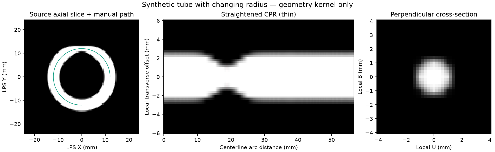

# CPR 几何内核首批验证

分支 `codex/cpr-reconstruction`，基线 `e505adf`。验证范围是 [CPR 设计中的 A 阶段](../superpowers/specs/2026-10-29-cpr-design.md)，不是完整 CPR 页面或发布验收。

## 实现与数值结果

- 三维 LPS 折线、按毫米等弧长采样、最小旋转平行运输、观察角度。
- 薄层/最大值/均值 CPR；真实物理横截面及其路径版本、源指纹、平面标定。
- 分块与取消，显式输出/采样工作上限，NaN 保留，无整套体数据复制。
- 抽取原 MPR 的三线性采样实现；保留 MPR 异常兼容接口。

针对 CPR、公共采样及原 MPR 的测试：补充复数坐标拒绝与极小间距溢出保护后 **126 passed**，仅已有的三项 SWIG 弃用警告。命令：

```sh
.venv/bin/python -m pytest tests/test_cpr_geometry.py tests/test_volume_sampling.py tests/test_cpr_reslicer.py tests/test_mpr_sampling_precision.py tests/test_mpr_reslicer.py -q
```

独立期望包括：直线与 MPR 一致；倾斜非等距体的解析线性场；10 mm 管状截面在一个输出像素内；粗采样仍保留所有未采样弯折的方向运输；中间越界区域留空；厚层排除无效值；采样中途取消不返回部分结果；不同分块大小完全一致。

合成变径弯管的源切面、实际内核 CPR 输出及对应横截面如下。此图不是产品页面截图，也不是真实患者影像。开发环境安装 matplotlib 后可用 `tests/manual/render_cpr_phantom.py` 重现，产品未新增该依赖。



## 可复现性能记录

```sh
.venv/bin/python tests/manual/benchmark_cpr.py build/cpr-core-benchmark.json
```

环境：macOS 27.0.1 arm64、Python 3.13.14、NumPy 2.5.2。合成体 `160×128×128`，CPR 输出 `161×326`，步长 0.25 mm、范围 40 mm。五轮中位数，仅包含数值采样，不包含解码、后台队列、调窗或 GUI。

| 工作 | 耗时 |
| --- | --- |
| 薄层 | 约 3.0 ms |
| 5 mm 最大值 | 约 37.2 ms |
| 5 mm 均值 | 约 39.0 ms |
| `161×161` 横截面（单次） | 约 1.6 ms |

301 个控制点拟合 1.5π 圆弧：47.123405 mm 对解析值 47.123890 mm，相对误差 0.001028%。螺旋：49.198321 mm 对 49.198785 mm，相对误差 0.000943%。这是折线近似误差，不是任意曲线或临床精度保证。

抽取前后公共采样对照：每轮约百万点、8 轮中位数，原实现 25.87 ms，新实现 27.07 ms；本机约 4.6% 差异，新接口增加非有限坐标校验。一次微基准不能代表完整阅片性能。

## 完整回归与基线问题

完整回归通过仓库的逐文件隔离工具执行：242 个文件，3,103 项通过、82 项跳过、1 项基线失败，无测试错误。详细原始日志保存在 `build/test-results-cpr/`。完整运行期间补充的 3 项异常输入测试已在最终 126 项相关回归中通过；原始完整运行日志保留不覆盖。

已发现并独立复现的基线失败：

- `tests/test_favorite_directories_ui.py::test_inline_favorites_many_resize_manage_and_reload`：offscreen 下横向滚动条最大值为 3，测试要求 0。用 `git archive e505adf src tests pyproject.toml` 导出的未修改源码、独立 `PYTHONPATH` 运行同一用例，得到同样失败。证据：`build/test-results-cpr/favorites-baseline.log`。本分支没有修改收藏目录代码。

## 独立代码复核

对 `e505adf..574610d` 的只读复核未发现 Critical、Important 或 Minor 缺陷；认可 A 阶段几何里程碑，不代表完整 CPR 页面可以发布。

- 复核者独立重跑相关测试：126 passed。
- 额外执行 20 组任意三维旋转、非等距体的横截面与解析物理线性场对照，最大误差 `2.16×10⁻⁵`。
- 检查结果数组的不可写 backing storage，`setflags(write=True)` 也不能使其可写。
- 建议后续把任意三维旋转横截面案例纳入永久测试。当前已有绕 Z 的倾斜体回归，额外抽样通过；该建议保留为后续覆盖增强，没有作为已发现缺陷处理。

复核暂不判断的事项及本次裁定：GUI/异步任务属于 B 阶段，因此入口暂不开放；工作区/旧测量恢复/导出属于 C 阶段，因此尚无完整成果保存流程；真实影像、临床可用性、Windows、主题及 DPI 属于 D 阶段，不能据此宣称通过。体数据在请求期间稳定不变是内核调用契约，后续 worker 必须保证该契约，否则像素与几何可能不一致。收藏目录失败已独立复现于基线，保留原问题，不跨入另一会话的发布修复；所以完整 offscreen 回归尚未全绿。

## 已知边界

- 本次没有 CPR 页面入口、鼠标路径编辑、后台 GUI 队列、工作区持久化或图片导出；这些有明确的 B–D 阶段依赖和验收要求。
- v1 使用折线，尖角是单侧切线；未引入未经验证的样条平滑。普通曲面二维距离/面积不具有统一标定。
- 没有 Windows、真实 CT/CTA/CBCT、深浅主题或高 DPI CPR 页面验收；本批不能据此声称完成完整首版。
- 不修改发布版本，不合并、不推送、不打包。
