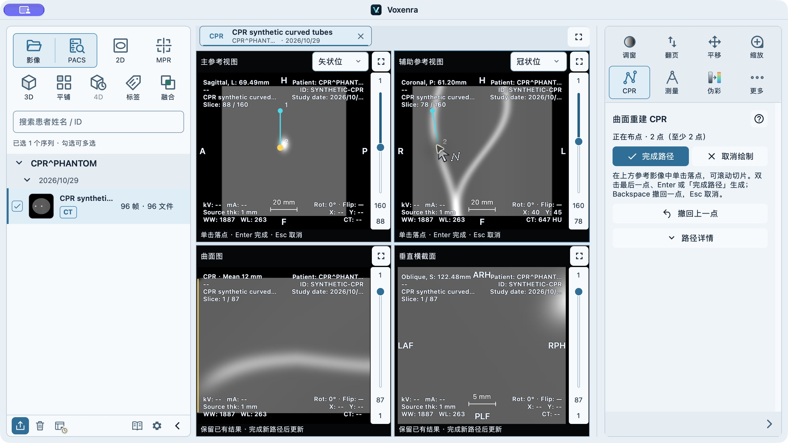
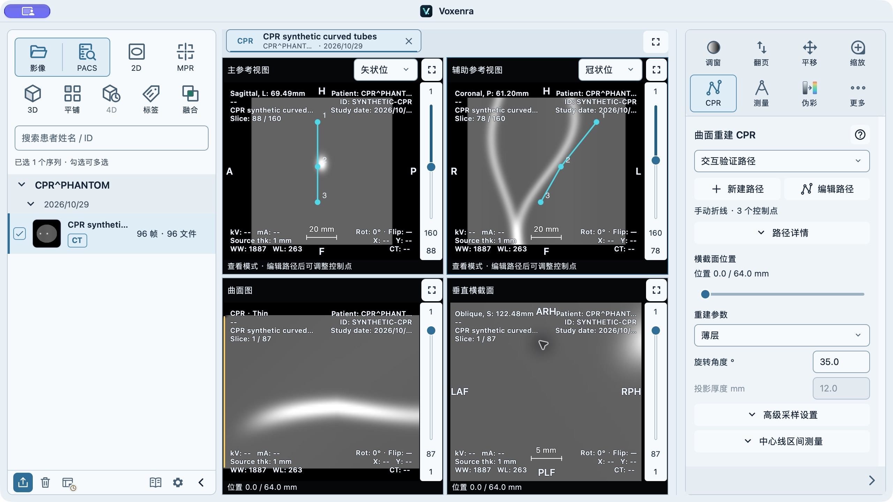

# CPR 交互调整验证（2026-10-30）

本轮针对建线确认、编辑防误操作、操作图标和右侧二级面板。使用现有 `codex/cpr-reconstruction` 分支；保留已通过 Slicer 对照的手动三维折线与采样算法，不修改工作区格式和测量来源。

## 修正

- 新建后显示布点状态、点数和常驻操作说明。至少两点才启用主要动作“完成路径”；支持双击最后一点、Enter 完成，Backspace 撤回，Esc 取消。虚线预览下一段。
- 双击的第二次 tap 不再加入控制点；对已落下终点附近的鼠标抖动也不再生成微小线段。另一切片上的点仍是独立三维点。
- 完成/恢复路径后默认查看；“编辑路径”显式启用拖点、插点和删点。退出编辑、切换工具、拖动取消的状态独立于持久几何。已完成路径至少保留两点。
- 横截面的 Delete/Enter 不再作用于参考视图路径。切到其他工具后草稿保留并暂停，其快捷键不会被路径完成动作截获；回到 CPR 可继续。
- 参考视图保留固定高度的状态行，切换查看/绘制/编辑时不再改变影像边界。绘制新路径时，下方旧影像明确标为保留的已有结果。
- 使用独立的连接控制点图标与对应指针。确认、取消、撤回、删除配合文字标识。
- 面板依次呈现路径选择及操作、截面位置、常用重建参数。名称、LPS 坐标及整路径删除移至“路径详情”；采样参数、区间测量分别折叠。薄层模式禁用投影厚度。可访问名称与中英文操作手册同步更新。

## 自动化验证

结果：**357 passed**，3 条第三方 SWIG 弃用警告。

运行 CPR 全部测试，以及共用鼠标指针、工具控制器、工作区交互、主题/语言、工具栏、帮助和影像覆盖文字测试。命令和结果见 [tests.txt](cpr-interaction-20261030/tests.txt)。使用 Qt offscreen + software backend；这些测试不等同于真实桌面验收。

新增行为回归均先复现失败，再修复：查看模式防插点、完成/删除快捷键归属、两点确认门槛、编辑退出回滚未提交拖动、工具切换暂停草稿、双击终点去重、近终点抖动与跨层落点、模式切换保持参考影像尺寸。独立只读代码审查未发现新增阻断问题；已补齐审查指出的草稿暂停覆盖缺口。

## 原生验证

通过 CUA 操作真实 macOS Qt 窗口，使用合成 CT，无真实患者数据。窗口 1280×720、DPR 2、中文浅色主题；每步核对可见 UI 与只读状态快照。

1. 新建、一点时完成按钮禁用、撤回上一点、两点时启用完成。
2. 双击第三个点：新路径确实只有 3 个点，`drawing=false`、`pathEditing=false`、`ready=true`。见 [双击状态](cpr-interaction-20261030/01-native-doubleclick.json)。
3. 查看模式点击线段不改变 3 点路径；打开编辑后同一位置插入第 4 点。Backspace 删除该点，拖动中间点并 Esc 退出编辑。中间点从 LPS `(78.4043,61.2,52.2829)` 移至 `(73.3936,61.2,50.4609)`，保留切面法向深度，最终 3 点、revision 4；这三个操作对应三个撤销记录。见 [编辑状态](cpr-interaction-20261030/02-native-edit.json)。
4. 两点草稿切到测量工具，在参考视图按 Enter：仍是 2 点草稿、3 条已完成路径，没有误确认。见 [暂停状态](cpr-interaction-20261030/04-paused-draft.json)。回到 CPR 后 Enter 成功完成两点路径。
5. 再建草稿、落一点、Esc：原来的 4 条路径保留。路径详情中重命名可用；投影切到薄层后厚度输入禁用。
6. 保存独立 `build/native-cpr/cpr-interaction.voxworkspace`，退出并重开后恢复路径与测量，编辑模式保持关闭。

验证边界：本轮未重复整库测试或 Slicer 数值实验；没有改动 CPR 几何内核。原生证据覆盖 macOS 中文浅色窗口，不能代替 Windows、其他语言和全部主题的人工验收。手动折线仍可能在尖角处产生截面方向变化；本次没有引入平滑样条或自动血管追踪。

事件处理参考：[Qt TapHandler 文档](https://doc.qt.io/qt-6/qml-qtquick-taphandler.html)，最终结论以本仓库的真实事件回归与原生操作为准。
