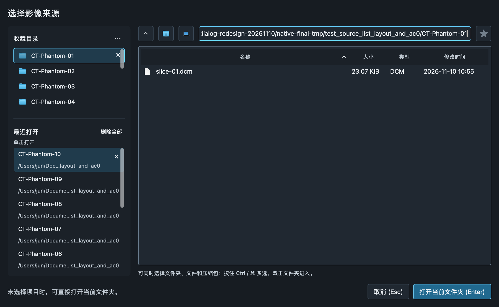
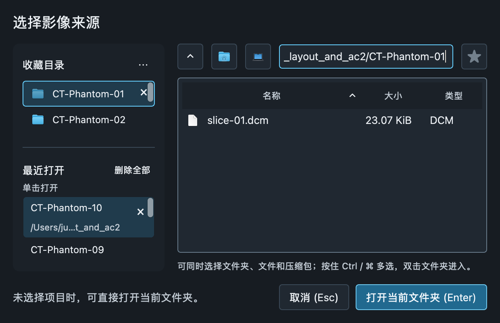
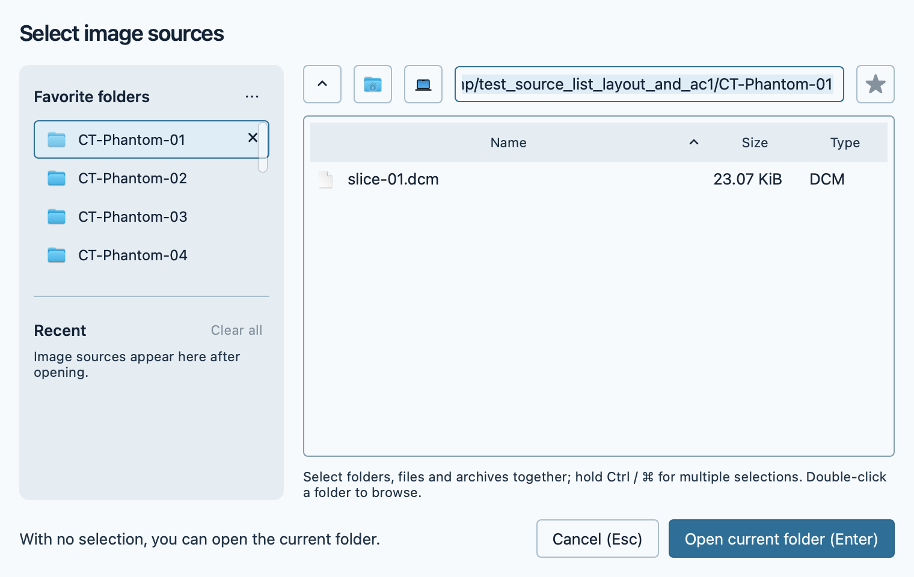

# 影像来源弹窗重构

2026-11-10。依据本轮要求扩大弹窗，重排来源与文件浏览区域，并增加最近记录的单项及全部清除操作。修改源码，未发布安装包。

## 布局与操作

- 默认尺寸由 880×560 调整为 **1040×640**；最小尺寸仍为 620×400，支持用户调整大小。
- 左侧集中放置收藏目录与最近打开，通过分区标题、分隔线和不同的信息密度区分。收藏显示目录名称与图标，最近记录显示名称与较淡的父路径。
- 右侧顶部为上一级、主目录、计算机、路径输入和收藏星标；下方为文件浏览区。窄窗口自动隐藏修改时间列，优先保留文件名空间。
- 底部统一放置选择摘要、取消（Esc）、打开（Enter），文件与来源列表分别滚动。
- 最近打开标题末尾提供“删除全部”；当前选中行末尾显示 × 清除按钮，按钮随选中项和滚动位置移动。
- 最近记录仍支持单击打开、Enter 打开、右键移除以及 Delete / Backspace 移除。按钮获取焦点时，Enter 执行对应清除操作，不会误触发打开。
- 单项清除与删除全部均只移除历史记录，保留源文件、收藏和当前浏览目录。清空后展示空状态，禁用“删除全部”。
- 中英文提示、无障碍名称与操作手册同步更新。

## 验证

- 新增清除操作回归用例：先确认旧实现缺少按钮而失败，再实现并通过。覆盖鼠标、Return、小键盘 Enter、滚动后的末行、620×400 窗口、历史持久化，以及文件、收藏和浏览目录保留。
- 最近列表与收藏控件最终 **32 项通过**。
- Cocoa 原生 GUI 验证最终 **59 项通过**，覆盖导入、收藏管理、最近列表及截图脚本；同时检查可见界面与操作后的状态。
- 实际复核深色中文 1040×640、浅色英文 760×480、深色中文 620×400，以及清空后的空状态。
- 原生窄窗口检查发现清除按钮曾被列表行最小宽度挤出边界，已修复并加入回归；深色主题的上一级图标改为随主题着色。
- 独立代码复核未发现本轮可执行的剩余问题。
- 全量覆盖 287 个测试文件，合并环境限制下的复测结果后为 **3835 通过、93 按条件跳过、0 失败**。首次沙箱运行无法绑定本地服务端口或运行 hdiutil，对所有受影响文件在沙箱外逐一复测后通过；未修改已安装应用。
- 最终布局与图标调整另由上述原生和控件回归覆盖；中英文手册与语言检查 **51 项通过**，`git diff --check` 通过。现存 SWIG 弃用警告不影响结果。

详细结果：[test-summary.json](import-dialog-redesign-20261110/test-summary.json)。

原生截图使用临时目录与合成 DICOM。复现脚本：[native-audit.py](import-dialog-redesign-20261110/native-audit.py)。

