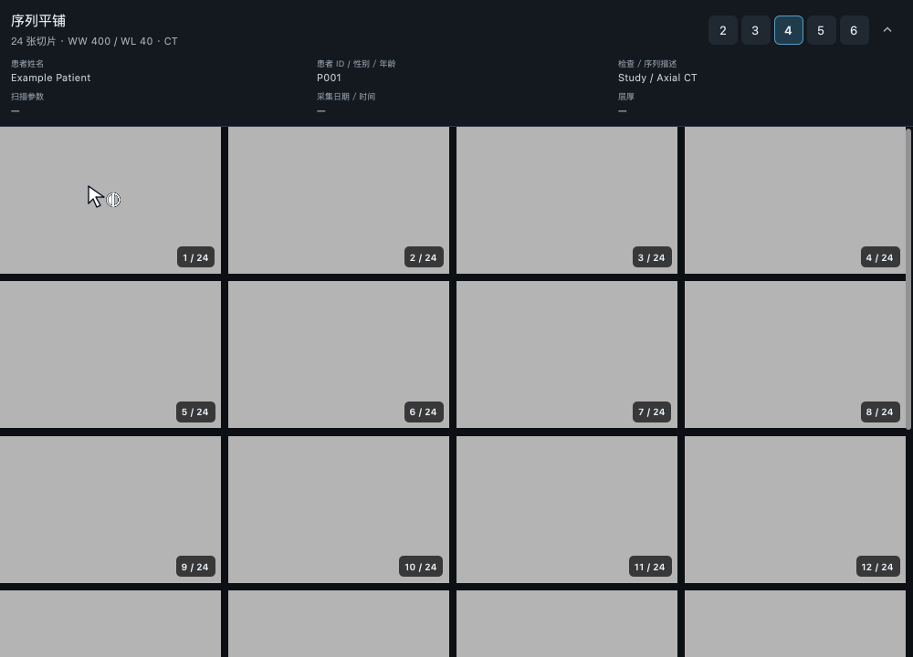
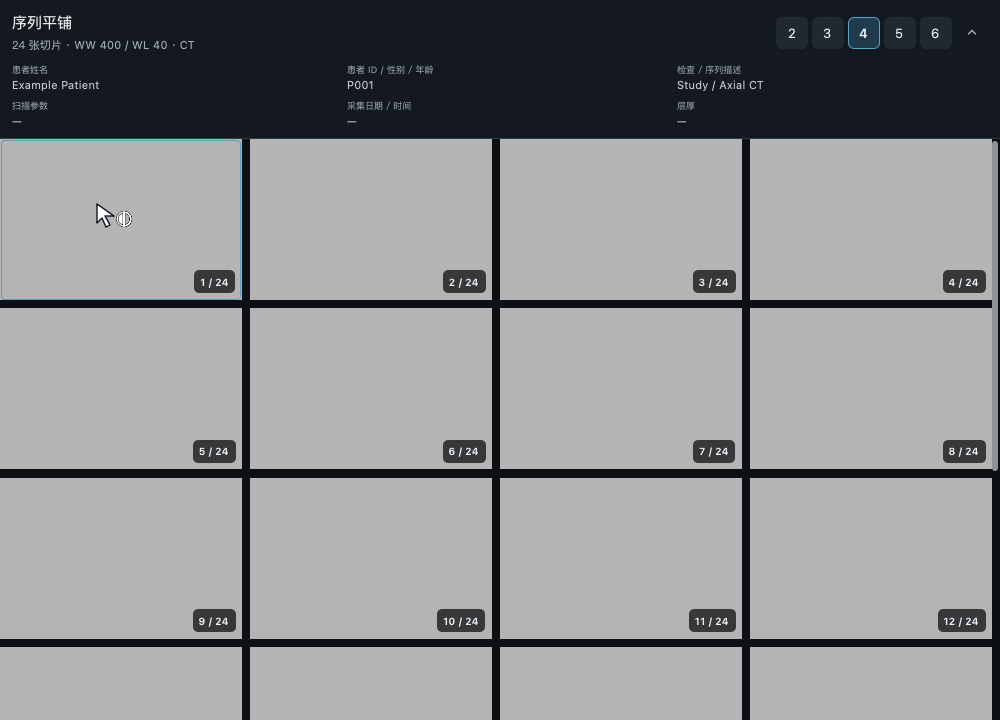

# 缩放后的视口边框验证（2026-11-09）

蒙太奇的悬停边框原先由缩略图父 Rectangle 绘制，子 Image 在缩放后覆盖父边框。悬停状态仍然成立，但边框像素变成了影像像素。另一个边界情况是网格高度有小数时，最底部的一行边框被 clip 裁掉。

修复将边框放到独立的透明上层，并内缩 1 个逻辑像素。影像的大小、变换中心、鼠标事件和缩略图间距保持原逻辑；移开鼠标仍取消悬停高亮。

## 验证范围

- 蒙太奇：使用均匀灰度影像直接检查四边像素，覆盖缩小、放大 3 倍、鼠标平移、旋转、镜像以及移出鼠标。同步确认影像仍显示、平移状态改变、缩略图几何不变。修复前放大用例失败：边缘采样值为影像的 `#b4b4b4`，而不是高亮色。
- 2D、MPR、4D、PET、融合、2D 对比、MPR 对比：明暗主题下检查激活状态及四边像素，覆盖缩放、平移、旋转、镜像。
- CPR：检查两个参考视图、曲面图、横截面图；变换后边框完整，路径及沿路径位置不变。
- macOS Cocoa：蒙太奇原生窗口验证通过；独立 3D 和 MPR 三维参考图分别通过原生双指缩放事件验证。检查原生渲染快照实际发生改变、活动视图正确、子窗口大小不变、外框完整。QQuickWindow 截图不包含原生 VTK 子窗口内容，因此另外保存并检查 VTK 快照。
- 其他视图未发现同类遮挡，无须修改其生产代码：普通布局有置顶边框与预留空间，CPR 的图像裁切区与边框分离，三维边框位于原生子窗口之外。

## 结果

4 个相关测试文件合计 **61 通过、4 跳过**，macOS 原生环境另外执行 **3 项，通过**。离屏跳过项包含两个本次原生边框用例，以及双指缩放文件已有的两个原生渲染用例。

测试文件：`test_montage_qml_runtime.py`、`test_viewport_selection_qml.py`、`test_montage_controller.py`、`test_pinch_zoom.py`。回归汇总位于 `build/frame-regression/results.json`；蒙太奇最终补充真实拖动和影像像素断言后的复测为 `build/frame-final-montage.xml`，5 项通过。`git diff --check` 通过。

## 修复前后

以下均为同一合成灰度影像放大 3 倍后的实际渲染截图。

